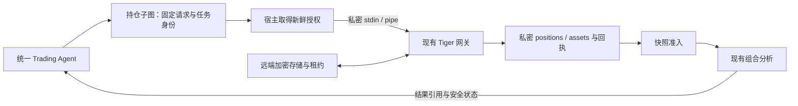

# Trading Agent 凭证存储与运行时访问

2026-11-16 决策：继续优先使用现有远端凭证服务。LangGraph 保存任务状态和
结果引用；Tiger 网关管理凭证、租约、刷新和写回。本地保留的工作 profile
用于恢复核对，不自动接管远端凭证。

用户已授权先做 Tiger smoke 和 blocker 检查，偏好远端存储；远端确实无法
使用时可以保留现有本地存储。这个选择不等于允许在结果不明时换路线重试。

## 已验证的情况

| 检查 | 结果 | 实际说明 |
| --- | --- | --- |
| Tiger smoke | 被恢复锁挡住 | `TIGER_PRIOR_OUTCOME_REQUIRES_RECONCILIATION`；没有新租约，没有券商读取 |
| 现有远端服务源码 | 已取回并固定 hash | 使用 Sites 支持的只读打开流程；没有 push、发布或修改 audience |
| 已保存版本的部署 | 成功 | 版本 1 的部署状态为 `succeeded`；这不是券商登录或读取成功 |
| 加密与并发设计 | 已核对源码 | AES-GCM、运行时 `VAULT_KEY`、条件 ETag 写入、租约、受限 read scopes；密钥值未读取 |
| 原提交的完整历史 | 不具备查询契约 | 服务只保存 `last_commit`；不是历史提交 journal |
| 本次远端只读诊断 | 已执行，原回执不可查 | 健康查询显示已初始化、租约不忙；原提交查询返回 409。共 2 次 HTTP、无重试 |
| 无人值守授权 | 未验收 | 当前新鲜 Sites service access 由宿主提供，普通 Python 进程不能自行获取 |
| 新的统一 Trading Agent | 尚未实现 | 只读诊断是迁移前的恢复工具，不能当作持仓子图已接通 |

原 checkpoint fence 和保留的工作 profile 没有被删除。原凭证服务仍是唯一
跨运行时凭证 owner；已有 Studio 实例和 MCP 快照保持原状。

独立验证分别保留了客户端 27 项通过、Worker 26 项中 24 项通过及 2 项失败。
两项 Worker 失败揭示了 commit-only 回执不能核对原租约，不会用修改断言来
掩盖。只读路径本身通过了零写入检查。Tiger 组件 52 项测试通过，其中包含
新增诊断客户端的 14 项测试。第一次本地诊断因源码权限不符、在 HTTP 前停止；
改用同 hash 的 0600 副本后完成远端诊断。所有记录分别保留。

## 子图怎样使用凭证

下面是待实现的接口安排。它复用已有能力，不新增凭证 broker 或第二套 refresh。

凭证不进入 prompt、工具参数、graph state、checkpoint、resume JSON、argv、
日志或 LangSmith。原始账户数据留在 workspace 的私密产物目录。模型需要
分析结果时，也必须先经过明确的数据投影和输出边界，不能直接附上整个 profile。

LangChain 的 [runtime context](https://docs.langchain.com/oss/python/concepts/context)
是单次调用依赖注入机制，[checkpointer](https://docs.langchain.com/oss/python/langgraph/persistence)
会持久化 graph state。这里采用的工程安排是：Graph 传递安全引用，宿主和
网关通过私密通道传授权。Runtime context 本身不保证日志、回调或异常中不会
泄漏凭证，因此仍需要在实际输出边界验证。

## 稳定运行还缺什么

首先是原写回的可靠核对。新诊断只发 GET `/health`，以及不携带 profile 或
release 的原 commit acknowledgement probe；独立测试先证明它不能写入。
即使收到 acknowledgement，也只表示服务认得最近一次 commit ID。它不会
证明原租约、profile 内容或历史 release。读不到历史时，恢复锁继续保留。

后续远端改进应提供只读历史回执查询，并在同一次条件写入中保存提交身份、
profile digest、版本和租约状态。还需明确原始提交身份与内容不一致时的拒绝
规则、保留期限和跨运行时恢复权限。这是候选契约，当前没有实现或部署。
不把 journal 中的 digest 当作凭证，也不把完整 profile 写入公开诊断。
新 journal 可以保留未来回执，不能补出过去没有记录的历史。当前故障仍需要
原 owner 的恢复核对或可验证历史证据；增加 journal 不能直接解除这次恢复锁。

其次是无人值守运行时的授权路径。未来运行必须独立获取短期 service access，
不能复用本次会话 bearer。实际未来触发的持仓读取、写回和独立结果核对通过后，
才能宣称调度路径可用；手动 smoke、部署成功或 handshake 都不替代这一步。

刷新仍由一个 owner 管理，Graph 和模型节点不额外叠加 OAuth/broker retry。
现有 gateway 的 store acquire/checkpoint 最多三次、每次 15 秒、相同身份和
字节；新诊断每项只尝试一次。429、超时、实际等待和未知结果分别记录。
Warmup 只能检验可安全读取的接口，不提前获取租约或触发凭证刷新。
[OAuth 安全规范](https://www.rfc-editor.org/rfc/rfc9700.html)说明 refresh token
rotation/replay 的风险；这里据此避免多个刷新 owner，没有声称观测到 Tiger
实际发生了 rotation。

## 本地存储的边界

远端确实不可用时，本地方案也必须有明确的唯一 owner。沿用 workspace 内的
私密目录、0700/0600、进程锁和原有恢复证据，禁止把凭证复制到 graph checkpoint、
公开 fixture 或配置示例。远端写回结果不明或旧 owner 仍可能刷新时，不自动
切换到本地；先完成 owner 交接和恢复核对。OS 级隔离、密钥备份与恢复目前没有
本次验收证据，不能从文件权限推导出这些保证。

## 后续迁移逐项验收

| 能力 | 保留的维护入口 | 统一 Agent 当前状态 | 下一项可观察结果 |
| --- | --- | --- | --- |
| Tiger 凭证与持仓读取 | `shared/tiger/` | 原子 owner 已有；新集成被恢复锁挡住 | 一次新鲜授权的 positions/assets snapshot 和 committed 回执 |
| 持仓准入与组合分析 | `investment/portfolio/snapshot.py`；`niulai/holdings/analytics.py` | 合成分析已有验证；真实新快照未接通 | 准入范围、币种、查询/价格时间及独立算术核对 |
| 计算与估值 | `shared/calculation/` | 既有原子能力；统一根图尚未集成 | 明确输入/输出/错误与公式绑定；新子图的正反用例 |
| 来源获取 | `shared/research_sources/`；`shared/web_access/` | 保留既有 owner；统一根图尚未集成 | 有范围、预算、实际来源和 unknown 状态的窄路径 |
| 投资研究 | `investment/research/pipeline.py` | 维护的 finalize/complete 保留；新编排未集成 | 来源覆盖、复核与完成回执，不能绕过 Niulai validators |
| 模型、宿主与调度 | 现有 session/runtime owner | 交互授权已有；无人值守未验收 | 独立未来运行与业务结果；按 runtime acceptance 记录 |

公开动作先冻结为 `analyze_holdings`，能力在同一个 `trading_agent` 根图内作为
内部子图接入。增加 calculation/research 动作前，先修改独立冻结契约，再验证
各自边界。不会把现有多个试验 assistant 当成最终交付。
