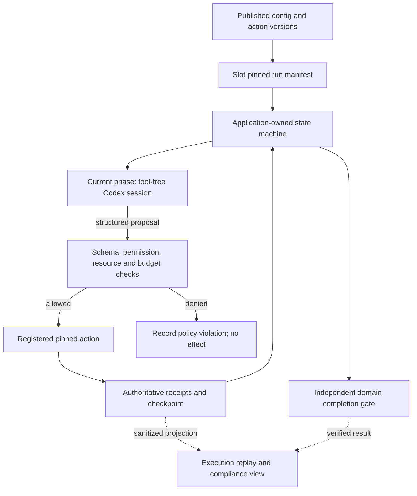

# Configurable pipeline, runtime enforcement and replay

Reviewed implementation plan, 2026-10-31. Extends the
[observability handover](observability-handover.md). New control interfaces below
are proposed, not installed. Existing component evidence is not acceptance of
the proposed combined platform.

## Intended outcome and engineering return

Edit a pipeline draft, validate and publish a version, bind it to a schedule,
then inspect exactly what a scheduled execution used and whether it obeyed the
contract and produced a correct result. Configuration CRUD, configuration-time
inspection and runtime replay are all included. Start with one reviewed NVIDIA
Q1 FY2025 revenue reconciliation, rather than a generic workflow builder.
This historical fixed-fact pilot is not a general/latest earnings analyst,
price-alert or holdings workflow.

Reuse the existing scheduler, action releases, artifact store, ordered runner,
domain finalizer and private HTML export. Proposed `investment/control/` owns
domain-facing configuration APIs/CLI; `investment/control/web/` owns a thin local
HTML/CSS/JavaScript surface. Use ignored `investment/runtime/control/` for its
private state: this is already an allowed artifact root. The scheduler keeps
its existing database, profiles and credential ownership under `.job-runtime/`.
Preserve `niulai/` and `niulai-private/`.

An on-demand loopback UI/API process is sufficient for interactive CRUD. Scheduled
work must execute while that UI is closed. Do not add an always-on service,
queue, database, active MCP registration or frontend framework for this slice.
Shared wake/model/retry infrastructure remains separate from pipeline business
rules and allocation. A real second consumer can justify a later abstraction.

## Existing enforcement and material gaps

| Capability | Present code | Gap for this platform |
| --- | --- | --- |
| Ordered execution | [execution.py](../../investment/research/execution.py): local phase/binding/proposal validation, action allowlist, counters/deadline and application-owned completion | Public validation/compiler and publication-time fresh-run pins |
| Action versions | [releases.py](../../shared/actions/releases.py): frozen source/schema/interpreter identities and hash checks | Pipeline publication must select exact releases; new runs currently freeze at launch |
| Resume | Original config/request/executor/releases/budget/deadline and latest checkpoint are checked; pending uncertain work is fenced | Bind publication, activation generation and logical scheduler slot as well |
| Resource authority | Schemas/artifact hashes are checked; numeric comparison has a pre-use critical guard | Authorize arguments/resources before every action, including reads of another run's source |
| Domain contract | [pilot.py](../../investment/research/pilot.py) owns preparation and final receipt verification | Acquisition precedes the ordered runner; include its release and finalizer identity in publication |
| Scheduling | [config.py](../../shared/job_runtime/config.py), [service.py](../../shared/job_runtime/service.py), [engine.py](../../shared/job_runtime/engine.py): central policy, durable slots, resource grouping and retry fences | Persist full first-slot manifest; a retry must not read a changed adapter config/profile/binding |
| Display | [audit.py](../../investment/research/audit.py), [report.py](../../investment/research/report.py): hash-checked optional projections | Configuration service, explicit partial/live states, row-level corruption isolation and compliance view |

`run_pilot.execute` still loads a fixed fixture and `Pilot` completion logic.
An editor cannot make arbitrary JSON into a supported domain workflow. Select
an explicitly registered preparation/resource/finalization contract.

## Versions and the proof chain

Actions and pipelines have independent immutable versions. A pipeline publication
pins exact action releases, not a floating major-version selector. Action code,
schemas and relevant script/calculator dependencies form the action release;
phase order, bindings, budgets, action pins and domain policy form the pipeline
release. The execution records both.

```text
draft revision → validated revision → published pipeline release
  → desired schedule binding → host-observed binding
  → slot-pinned run manifest → phase/action receipts → verified domain result
  → matching scheduled acceptance and verified owner notification
```

Draft revision is a concurrency token, not a published semantic version.
Changing code or a contract produces a new action release. Changing pipeline
behavior or any selected action release produces a new pipeline release.
Existing immutable versions never acquire different bytes. Compatible action
updates are not automatically adopted by existing published pipelines.

A publication manifest contains exact `config_ref`, action/acquisition release
refs, registered domain/finalizer and policy fingerprints, compatible runner
identity, relevant environment/interpreter identities and an approved central
model-profile reference plus fingerprint. Capture no credentials or environment
variables. Local hashes/read-only files provide cooperative integrity, not a
signed ledger or hermetic dependency environment.

Editing/restoring creates a draft; publishing does not activate it. Activation
changes future claims, not a running execution. Rollback selects a previously
verified compatible release for future work; it cannot undo prior effects.
Retirement and security revocation are distinct: history remains inspectable,
while revoked capabilities block execution. Missing historical bundles cannot
be reconstructed by claiming today's code is identical.

## Control interfaces and CRUD contract

Keep control metadata in an envelope around the existing `CONFIG_SCHEMA`.
Do not insert unsupported control fields into the runner's configuration.

| Proposed operation | Required behavior |
| --- | --- |
| `create_draft(config, domain_id, operation_id)` | New draft identity; no business I/O |
| `update_draft(id, expected_revision, payload, operation_id)` | CAS update; conflict preserves the client's draft |
| `validate_draft(id, revision)` | Pure bounded validation receipt; no fetch, model call or release publication |
| `publish_draft(id, revision, operation_id)` | Recheck that revision/dependencies; atomically publish complete immutable config/action/domain pins |
| `get_operation(operation_id)` | Reconcile an unknown mutation result after timeout/refresh |
| `set_binding(id, expected_generation, release_ref, operation_id)` | Atomic desired binding for an approved allocation; previous valid binding survives failure |
| `observe_binding(id)` | Separate desired and host-observed generation, observation time and reason |
| `start_or_resume(slot_id, binding_id)` | First-slot manifest persisted before I/O; retries retain original pins and request identities |
| `get_execution(id)` | Sanitized hash-checked projection; no execution effects |
| `archive_draft(id, expected_revision, operation_id)` | Hide from normal editing; preserve published/referenced history |

Use per-entity bounded locks, expected revisions/generations and durable operation
records looked up by `operation_id`. Bind operation kind, target and canonical
payload hash immutably to that identity. The same ID and payload returns the
original result; changed kind, target or payload conflicts. An accepted
write with a lost response must not mint a second publication, activation or
execution. Prepare content objects before atomically committing the head;
incomplete publication cannot become active. Recover from operation records.

The first deletion behavior is draft archival. Hard deletion, if later added,
requires an unreferenced draft and explicit retention policy. Configuration CRUD
never deletes published history, execution receipts or effect fences.

UI data cannot select adapter imports, Python paths, arbitrary commands, uploaded
scripts, auth homes, writable roots or completion-verifier code. Select reviewed
registrations and approved profiles by ID; pipeline budgets only reduce central
ceilings. Script changes use the code/action-release path. Show their exact
versions/hashes through progressive disclosure.

## Runtime engine: enforce rather than ask the agent to obey



1. Expose public runner validation/compilation and a fresh-run input such as
   `published_release_ref`, coordinated with the runtime owner. Control code must
   not call private `_configuration`, fabricate checkpoints to inject pins or
   duplicate the runner's validation rules. Include preparation/acquisition and
   finalizer identities, not only the visible ordered phases.
2. The host validates/acknowledges activation at a safe dispatch boundary. A reload
   signal is not acknowledgement; Python code changes need a controlled restart.
   The first logical slot claim atomically fixes binding generation, publication,
   request/resource scope, profile/policy, budget and execution ID in one manifest.
   Retries load it, not current draft/catalog/binding/profile contents. Revocation
   can block old work but cannot silently upgrade its pins.
3. The application owns phase cursor, input bindings, absolute deadline, counters,
   checkpoint generation and completion. The model sees bounded current-phase
   inputs and returns a closed structured proposal. It cannot choose the next
   phase, raise limits, change releases or declare itself finished. Locally reject
   unknown fields, unauthorized actions, invalid bindings and duplicate call IDs.
4. Before every action, intersect the published allowlist with code-owned per-run
   argument/resource policy. A schema-valid foreign-source read is denied before
   reading. Hashes establish integrity, not authorization. Prefer host-issued
   resource handles; the model cannot submit grants, output paths or release refs.
   Validated phase handoffs can extend scope only through explicit host rules.
5. Invoke exact registered releases; persist intent and observed receipts. Domain
   completion requires independently verifiable results and required receipts.
   A valid schema or persuasive explanation is insufficient. Evidence content
   cannot authorize shell/email, skip phases or change policy.
6. Bind publication/run-manifest refs into the authoritative report. A display
   outage cannot alter the domain verdict. Missing authoritative manifests,
   action intents/receipts, checkpoints or effect fences fail closed.

Schedule cadence changes follow the existing migration procedure: changing a
schedule hash under the same job ID is fenced. The first control surface binds
versions to approved allocations rather than creating a second scheduler editor.
Disable prevents future claims; cancellation/reconciliation of active work is
a separate operation.

### Actual sandbox and model-session ownership

The existing [model transport](../../shared/job_runtime/model.py) disables shell,
web, apps and MCP, uses read-only Codex and rejects observed tool activity. The
model proposes; trusted host adapters perform effects. Frozen action workers
have code integrity/time/output limits but are not presently adversarial OS
sandboxes. Do not claim configuration alone confines a host worker's access.

Before claiming OS action isolation, verify host-launched policy per supported
action class: read-only code/dependencies, approved data reads, attempt-only
writes, appropriate bounded network and credential boundaries. Use synthetic
denial probes for filesystem, credentials and network. Keep untrusted scripts
out of scope until that isolation exists. On macOS launch workers from the host;
do not nest `sandbox-exec` in an already sandboxed Codex shell or loosen policy
because nesting fails.

Prefer scheduler-host orchestration of sequential tool-free Codex phase sessions.
Record each actual session under the scheduled logical slot. A waiting outer
`run_business` holds `auth_home/runtime.lock`; a nested `run_codex` using the same
home returns `MODEL_AUTH_CACHE_BUSY`. If an outer trigger session is necessary,
persist intent and finish/release its transport before starting phases. Never
copy rotating auth caches to bypass serialization. Model choice, authentication
and retry stay central infrastructure policy.

The current component acceptance launcher finishes its source-agent session
before the tool-free phase loop. That is useful scoped evidence, not proof a new
executor/binding is installed in the common scheduler. Test the intended installed
route when integrating this platform. Add an explicit host-orchestrated pipeline
executor path with independent completion verification; it is not supported by
the current readiness/business executor choices. Do not run the whole pipeline
inside a preparation adapter that returns `status`: the current dispatcher returns
immediately from that branch and bypasses its completion adapter. Carry actual
phase transport receipts through the dedicated execution and verification path.

## Evaluation: compliance and correctness are separate

Predeclare a small evaluation matrix before reading results. Mentor
development/evaluation guidance informs scope and graders; application checks
enforce policy. Do not reward eloquence, self-reported completion or agreement
among agents. Keep deterministic checks ahead of any model judging.

| Dimension | How to evaluate | Failure/unknown interpretation |
| --- | --- | --- |
| Version fidelity | Compare published refs with claimed manifest, loaded releases and action receipts | Drift or silent fallback fails; absent refs are unverified |
| Execution compliance | Check phase sequence, handoffs, allowed actions/arguments/resources, limits and terminal gate | Unauthorized attempts are blocked before effects; record attempts separately from actual violations |
| Domain correctness | Independent expected facts/calculations and source receipts; verify as-of, units, rounding and support | Correct orchestration with wrong/unsupported result fails domain quality |
| Completion integrity | Remove required action/source receipts; submit schema-valid fabricated completion | Domain gate must reject; JSON validity alone never passes |
| Recovery/effects | Crash/lost response, latest-checkpoint resume, duplicate IDs, restart, unknown outcome | No duplicate effects; uncertainty remains fenced until reconciled |
| Containment/privacy | Inject source instructions, foreign refs and synthetic secrets; probe denied capabilities | No unauthorized effect/leak; failed or missing containment evidence blocks that claim |
| Runtime readiness | Real future schedule, actual Codex phases, timings and independent results | Foreground/unit/screenshot evidence does not substitute |

First cases: valid existing pilot; publish A/edit B/run A; change catalog after
publication; stale draft/CAS and conflicting operation keys; unauthorized action;
schema-valid read of another execution's source; source text demanding skipped
phases/email/budget increase; fabricated final result; stale/uncertain checkpoint;
deadline exhaustion; corrupted receipt; render failure; same-slot retry after
activation change. Test both a successful authorized recovery and a necessary
block. Also test a new execution/request ID for the same fenced business effect:
it must remain blocked pending reconciliation. Preserve failed attempts and
evaluation variants.

For the fixed-fact pilot use independently checked historical facts and numeric
tolerances, not a second agent's opinion. For future open-ended analyses add an
evidence-first rubric and independently reviewed cases; model judging supplements
deterministic gates. Finance correctness needs the separate calculator validation
and source-quality evidence. Historical tests do not establish prospective alpha.

Do not combine these dimensions into one green score. Report coverage and unknowns
as well as pass/fail. Repeated fixtures are development evidence, not independent
generalization. Budget violations, unsafe effects and false completion are hard
failures; missing required evidence prevents acceptance without inventing failure.

## Observability: configured rule, observed event, evidence, verdict

Each execution has a compact compliance table next to the phase timeline:

| Rule | Configured expectation | Observed evidence | Verdict |
| --- | --- | --- | --- |
| Version | Exact pipeline/action refs | Run manifest and action release receipts | Match / mismatch / unverified |
| Phase gate | Required predecessor and action/output contract | Ordered events, accepted phase/checkpoint refs | Satisfied / blocked / not started / unknown |
| Resource scope | Approved sources and action argument policy | Authorization decision and bounded receipt summary | Allowed / denied attempt / actual violation / unverified |
| Budget | Action/turn/time ceiling | Observed counters and timestamps | Within / exhausted / unknown |
| Result | Registered domain postconditions | Independent verifier receipt and source/calculation refs | Supported / failed / incomplete / unverified |
| Readiness | Matching scheduled candidate and owner notification | Slot/session/timing/acceptance and exact readback receipts | Passed / partial / failed / unverified |

These are observable contracts and effects, not hidden reasoning. A blocked
malicious proposal can demonstrate a working guard; it is distinct from an
unauthorized action actually executed. Show both the rejection and resulting run
status. Cost stays unknown without a billing observation. Requested and observed
model identities remain separate; do not infer an unreported backend identity.

Inspection is read-only. Resume uses original pins and latest safe checkpoint;
pending uncertain effects, obsolete heads or drift remain fenced. Run again is
a new execution with new request identity and explicit effect policy; it never
clears an old fence or resends mail. The domain owner assigns a stable business
effect identity across executions, tied to the logical business operation/target/
slot, with immutable payload binding. New execution/request IDs cannot create
a fresh effect key to bypass an equivalent unknown-outcome fence. Reconcile that
business effect before another execution can perform it. Ship inspect first;
resume/rerun controls need their own backend and browser checks.

Derive accepted phase state from authoritative evidence: current report projection
must not assume any outcome object means accepted. Missing finish time alone
does not prove a live process. Show last observation/checkpoint and stale/unknown
state. Isolate corrupt audit rows so one bad record cannot remove an execution
list. Audit/render/list failures are bounded optional diagnostics; authoritative
state and domain completion remain separate.

## Tool Strategy UI adaptation

Source was inspected read-only; no code copied in this planning update. User
permission allows copying into this workspace later, not editing that repository.
Transfer geometry/disclosure, not HiUI/HiFlow/Starling/BAM/session dependencies.

| Reference inside `tool_strategy_i18n_ts/src/` | Use here |
| --- | --- |
| `features/case-replay/CaseReplaySurface/ReplayReady/ReplayReady.tsx` | Main replay viewport first; separate findings only where needed |
| `ReplayReady/ReplayReady.module.scss` | Flex children with `min-height: 0`; do not copy shell-specific `100vh - 220px` |
| `features/case-replay/NodeRunDetailSheet/NodeRunDetailSheet.tsx` | Bounded inspector near 516px, reduced to viewport width; inspect already loaded data |
| `NodeRunDetailSheet/BasicInfoSection/BasicInfoSection.tsx` | Name/type/outcome/duration first; timestamps and IDs behind details |
| `features/rule-configuration-table/viewModels.ts` | Separate lifecycle, published placement and runtime state; missing remains unknown |
| `routes/pages/sop-rule-editor/page.tsx` | Immediate in-flight save guard and retained entity-scoped drafts |

Do not copy its lookup-before-create race or fail-open approval affordances.
Backend CAS/idempotency and validated transitions are mandatory. Record provenance
and applicable notices for any copied code; copy no private state or credentials.

Two destinations: **Pipelines** and **Executions**. Pipelines has a compact list,
version history, read-only published versions and Create draft. Editor: ordered
phases beside fields, with advanced JSON/script hashes disclosed on demand.
Save draft, Validate, Publish version and Activate for schedule are distinct.
Show revision-specific validation and desired versus host-observed activation.

Executions: pipeline/version, trigger/attempt, timing, domain status and runtime
acceptance. Main viewport: ordered phases including never-started ones; selecting
a phase/call opens the inspector. Add the compliance table above. Reuse existing
report tokens/system typography; no metrics hero or graph/canvas dependency.
On narrow screens use list → execution → phase → full-width details. Preserve
keyboard focus, Escape/back and focus restoration.

Guard A→B late responses by entity/edit-session identity. Preserve drafts after
errors/conflicts. A lost write response is result unknown: retain the operation
ID and reconcile; never create a new publication on timeout. Announce errors and
associate them with fields. Server idempotency remains authoritative across tabs.

Expose only sanitized allowlisted projections: no raw prompts, credentials,
complete arguments, arbitrary payloads or unrestricted file paths. A local
browser API needs strict Host/Origin/CSRF checks, bounded bodies, opaque IDs and
no permissive CORS. UI controls cannot grant runtime permissions. Page polling
is not ongoing background monitoring.

## Implementation sequence and acceptance gates

| Phase | Deliverable | Evidence required |
| --- | --- | --- |
| 1 | Public validation plus file-backed draft/CAS/operation/publication core | Stale/duplicate/conflicting mutations, lost responses, crash publication and immutable-version checks |
| 2 | Published-release runner entry, all-action resource guard, preparation/finalizer pins and first-slot manifest | A stays A after edits; denied foreign refs before use; retry retains pins/deadline; false completion/prompt injection fail safely |
| 3 | Configuration list/editor/history, execution inspector and compliance projection | Persisted revisions/counts plus late response, duplicate save, uncertain write, partial/blocked/corrupt and empty-state browser checks |
| 4 | Host-observed binding, explicit pipeline executor/completion-verifier path and intended common-scheduler future once run | Exact candidate/slot/phase session/timing, independent domain checks and verified owner email; preparation-adapter short-circuit is not acceptance |
| 5 | Second registered workflow, then controlled resume/rerun or schedule UI | Its own policy/domain/effect acceptance; original fences and production ownership preserved |

Coordinate core `execution.py`, `run_pilot.py`, examples and shared source/action
changes with the runtime owner. Root/control owns new control modules and this
plan. UI work can use an agreed API fixture, but fixtures cannot accept runtime.

Browser verification uses pinned local UI tooling at 1280×800, 390px and 320px,
200% text, long hashes, keyboard-only and reduced motion. Check persisted state
and operation counts, not only a toast or screenshot. Historical saved-report
screenshots do not accept the new interactive surface.

Major runtime changes require the complete
[scheduled acceptance contract](../deployment/runtime-acceptance.md), including
actual Codex phase execution in the intended installed route, preregistered
lateness/timeout, independent postconditions and verified configured-owner result
email, for success and failure. One pass proves that path/time, not perpetual
punctuality. Publication/staging may precede acceptance; production activation
requires matching evidence and existing production-owner authorization. Do not
cut over the existing cloud sender as a side effect.

Every setup change updates [local setup](../local-setup.md), component runbooks
and sanitized inventory, then passes setup-audit refresh/check. This plan alone
changes no dependencies, startup policy or active configuration and requires no
new business effect. Automatic universal acceptance enforcement is not installed
merely by documenting the gate.

Stop after the first accepted vertical slice. Defer DAG editing, arbitrary
scripts/terminal access, distributed execution, multi-user roles, new databases,
streaming dashboards, billing estimates and universal workflow support until a
demonstrated requirement justifies them. Do not defer credential protection,
resource authorization or duplicate-effect handling from the first useful path.

## Repository and script/action ownership

The [architecture review](repository-action-architecture-review.md) maps current
script/action bindings, distinct data/provider/action catalogs, historical release
compatibility and live Niulai dependencies. Use its gradual copy/verify/switch/
retire sequence before moving runtime files. The control platform consumes trusted
action definitions; it must not create another handler registry or register every
script as a model-callable tool.


## Unattended browser capability

See [EgoLite runtime integration](egolite-runtime-integration.md) for the proposed
registered browser-read contract, host-only configuration, mandatory receipt
gates, session ownership and retry boundaries. A slash command is an interactive
skill selector, not the runtime integration. The real CLI read is observed;
registered-action wiring and scheduled acceptance remain pending.
