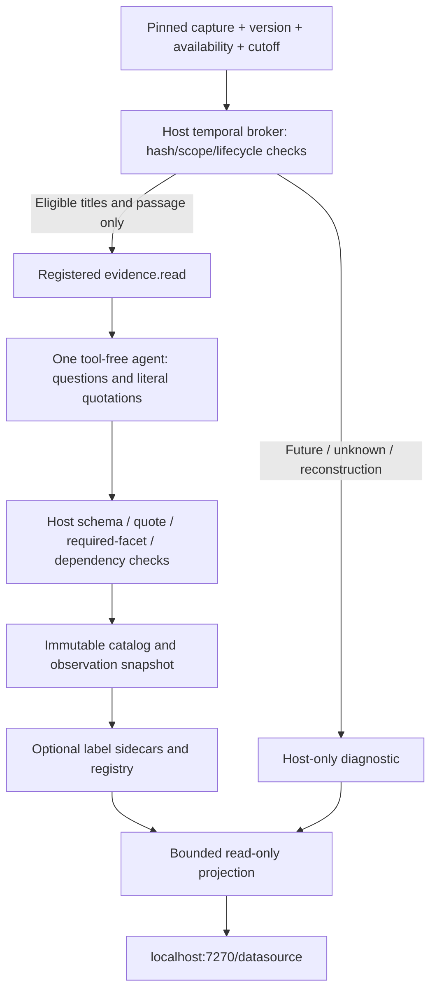

# Datasource observation and point-in-time exposure

The implementation reuses immutable source artifacts, the existing phase/action
runner and a small read-only projection. It adds no new database, scheduler owner,
source quality score or LLM router.

The UI separates a source's latest diagnostic from its actual execution-bound
guard. Only the exact final snapshot, source hashes, diagnostic and execution ID
can establish that a displayed run was guarded. A newer source diagnostic cannot
retroactively validate an earlier run. Reconstructed historical A/B cohorts remain
explicitly non-strict; failed graders are retained beside captured repair metrics.

## Professional ML basis

Professional systems distinguish **event time** from **when a particular version
became available**. Feast's current [point-in-time join design](https://github.com/feast-dev/feast/blob/master/docs/getting-started/concepts/point-in-time-joins.md)
describes how event-only joins can leak later corrections and how creation-time
constraints address availability. This is current master documentation, not proof
that a deployed Feast release supplies these semantics or that timestamps are
historically authentic. The implementation here uses its own source receipts.

[AWS/GoDaddy's point-in-time dataset design](https://aws.amazon.com/blogs/machine-learning/build-accurate-ml-training-datasets-using-point-in-time-queries-with-amazon-sagemaker-feature-store-and-apache-spark/)
keeps event time, API invocation time and offline write time distinct and selects
versions per example's cutoff. The analogous evidence rule is to preserve later
corrections while keeping them out of earlier runtime packets.

[scikit-learn's leakage guidance](https://scikit-learn.org/stable/common_pitfalls.html#data-leakage)
requires splitting before preprocessing/selection; test examples must not influence
tuning. [TimeSeriesSplit](https://scikit-learn.org/stable/modules/generated/sklearn.model_selection.TimeSeriesSplit.html)
supports time-respecting folds and a gap, but does not authenticate document
versions, prevent cross-company overlap or undo model pretraining. Use an embargo
covering the outcome horizon where targets overlap, separate tuning from protected
evaluation, and retain all attempted variants. No new protected benchmark has been
claimed by this implementation.

[Google's Rules of ML,29–33](https://developers.google.com/machine-learning/guides/rules-of-ml)
recommend logging serving-time features, accounting for mutable joins, sharing
training/serving transformations and evaluating on later data. Our corresponding
engineering choice is to record the exact packet/action/model receipts and reuse
the same temporal broker in synthetic tests and the actual model query. Filtering
before title/snippet exposure is an application of these principles, not a claim
that the cited sources tested our code.

## Effort and claim limits

The high-ROI slice is one current-cutoff NOW captured-source query, provisional
labels, bounded introspection and failure-injection tests. It does not fetch all
five catalog facets automatically, validate every financial conclusion, measure
forecast improvement, establish investment alpha or certify universal historical
availability. Broader multi-ticker retrieval A/B requires source-version coverage,
sealed matched inputs/budgets and independent scoring before a gain claim.

Temporary future acceptance records and rendered screenshots live in ignored
component runtime paths; the deployment runbook gives reproduction commands.
