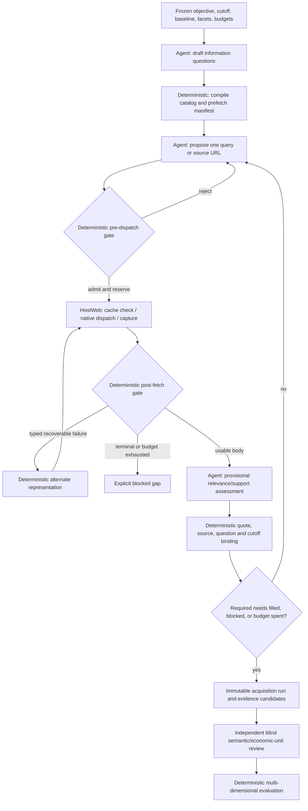

# Deterministic acquisition controller

Status: **LANDED AS HISTORICAL ATOMIC CAPABILITY** on 2026-11-05. Controller/component integration is implemented and locally verified; real hosted-provider execution and matched information-yield evaluation remain separate unverified gates.

Date: 2026-11-04

## Decision

Keep **information discovery agentic** and make **execution control deterministic**.
The model may decide what question to ask, which source role could answer it, and
which query or URL to propose. Application code owns admission, budgets, exact
arguments, cutoff enforcement, cache/fallback policy, provenance, quote binding,
retry limits, stopping and the immutable trace.

This is the smallest useful seam between the compiled runtime information catalog
and `HostWeb`. It does not replace the existing evidence store, cache, HostWeb,
ordered action runner, datasource UI or acquisition grader.

## Observed failure being addressed

The sealed NOW round-v2 comparison is one development case, not a population
estimate. Under matched budgets, arm A obtained 15 supported new information units
versus 22–23 for arm B, took 283.4 seconds versus 160.6 seconds, and lost three of
eight read slots. One PDF exceeded the native body limit and two PDF URLs were not
accessible through the native tool. All three originally collapsed to
`HOST_WEB_BODY_UNPARSEABLE`; no typed alternate-representation recovery preserved
the unresolved adverse/customer/competitor fields.

The current repository already implements immutable artifacts, cutoff screening,
exact cache keys, singleflight, bounded batch retries, action releases, HostWeb
receipts and a blind acquisition grader. The missing link was a controller that
turns a compiled question plan and actual read outcomes into the next bounded
operation.

## Pipeline and node ownership

### What the prefetch manifest means

It is not a hard-coded per-company URL list. It freezes:

- question and requirement IDs;
- required facets and dependencies;
- evidence sought and acceptable source roles;
- declared retrieval capabilities;
- priority and stop rule;
- search, open, provider and reserve budgets;
- ownership: agent proposes; code admits, retries, accounts and stops.

A static URL may be supplied when a stable official endpoint is known. Runtime
source discovery remains agentic because companies, products and source surfaces
differ. Exact URLs discovered at runtime are still screened and bound to the
question before dispatch.

### Deterministic pre-dispatch checks

1. Exactly one search/open/find item per proposal.
2. Proposal binds known question IDs and an allowed source role.
3. Required-budget reserve cannot be consumed by optional exploration.
4. Exact duplicate operations and previously failed URLs cannot be retried.
5. Search/open/provider budgets are reserved before dispatch.
6. PDF proposals require at least one different HTTPS alternate representation.
7. Only one unresolved operation may exist at a time.

### Deterministic post-fetch checks

1. Classify transport, deadline, future exposure, oversized body, inaccessible
   source and unparseable body separately.
2. For returned search metadata, require at least one portable HTTPS candidate.
3. For returned documents, require exact URL binding, a usable body and a retained
   source reference.
4. Agent-proposed support must quote an exact substring and bind it to a planned
   question. It remains `supported_partial`, not final semantic admission.
5. A recoverable open failure may consume one declared alternate at a time. The
   same failed operation is never retried unchanged.
6. A terminal failure, exhausted budget or absent compatible alternate produces an
   explicit blocked gap rather than empty-success output.

Original-lineage deduplication, canonical economic-unit review and source-quality
judgment remain in the existing acquisition evaluator. They should not be
silently duplicated inside transport control.

## Landed atomic capability

- `investment/research/acquisition_orchestration.py`
  - compiles an executable prefetch manifest from a validated information plan;
  - provides a single-writer controller around one-operation-at-a-time proposals;
  - enforces reserve, budget, duplicate, failed-URL and PDF-alternate rules;
  - performs structural post-fetch and exact-quote checks;
  - deterministically queues a different alternate representation;
  - emits immutable decision transitions and an explicit-gaps summary.
- `shared/research_sources/host_web.py`
  - version advanced to `host-web-1.2.0`;
  - preserves `HOST_WEB_BODY_TOO_LARGE` and
    `HOST_WEB_SOURCE_INACCESSIBLE` rather than collapsing explicit native-tool
    diagnostics into a generic parser failure.
- Focused tests cover manifest projection, reserve protection, duplicate rejection,
  PDF alternate requirements, typed recovery, quote binding, blocked gaps and
  terminal failures.

This is not yet connected to a hosted-native model/tool loop. No claim is made that
it improves live retrieval quality, cache hit rate, freshness or investment alpha.

## Evaluation architecture

Do not use one weighted quality score. Report dimensions separately and fail on a
critical integrity regression even if another metric rises.

### Acquisition integrity gates

- same dated baseline, cutoff, questions, model request, backend and budgets;
- all search/open/provider items counted, including failures and alternates;
- every credited unit comes from an opened, eligible source version and literal
  support;
- complete arm-blind pooled review;
- no future/unknown-version exposure in historical cases;
- no unresolved unknown outcome replay;
- grader, candidate and baseline versions frozen before dispatch.

### Primary information-quality outcomes

| Dimension | Operational measure |
| --- | --- |
| Breadth | Unique supported new canonical information units by facet; original independent lineage count |
| Required coverage | Required facets with at least one eligible supported unit; bounded-reference recall where a reference exists |
| Depth | Coverage of separately declared mechanism, adoption, unit-economics, technical-limit and counterevidence fields; no credit for prose length |
| Freshness | Verified event/publication/version availability to first eligible capture lag; report unknown-lag rate separately |
| Read yield | Usable opened bodies / read slots; failures by typed reason |
| Precision | Supported canonical units / all judged candidate units |
| Redundancy | Duplicate/syndicated/equivalent units before and after canonicalization |
| Traceability | Fraction of credited units with question, query, operation, source version, quote, lineage and reviewer binding |

Latency, provider calls, cache hits, tokens and monetary cost are secondary resource
outcomes. Unknown token/cost values remain unknown and cannot support an efficiency
claim.

### Falsifiable staged experiment

The NOW result was already observed, so fixes tuned from it are exploratory.

1. **Deterministic fault cohort**
   - Inject oversized, inaccessible, malformed, transport and unknown-outcome
     responses.
   - Expected: a different compatible alternate is used only for recoverable
     failures; terminal/unknown outcomes never redispatch; all attempts count.
2. **NOW source-recovery replay**
   - Freeze the previously selected source candidates and read budget.
   - Compare old generic handling with typed alternate recovery.
   - Prediction: read yield rises from 5/8 without exceeding eight read slots;
     this tests recovery only, not general retrieval superiority.
3. **Matched live acquisition development cases**
   - B: competent normal native search/opening.
   - A: the same backend plus catalog, controller and typed recovery.
   - Match cutoff, old context, model request and search/open/provider budgets.
   - Report A minus B per dimension and per facet. Preserve ties/regressions.
4. **Ablation**
   - catalog only;
   - catalog + deterministic admission/accounting;
   - catalog + controller + typed recovery.
   This distinguishes planning value from recovery value.
5. **Untouched temporal/ticker confirmation**
   - Predeclare cases not used to develop the controller.
   - Keep future bodies, future metadata, other-arm output and reference units out
     of worker context.
   - Require replication across more than one company/time window before any broad
     promotion claim.

Stop a run at the frozen budget, a terminal/unknown outcome, all required needs
filled or explicitly blocked, or the deadline. Do not rerun because the quality
result is disappointing.

## Web research boundary

Native web search and source opening succeeded for the core sources on 2026-11-04.
Two Microsoft Learn page opens failed without output, so those pages are not used
as opened supporting evidence here. The useful external patterns were:

- StateRAG: model components propose state updates while a controller validates and
  commits typed state; failed verification triggers a bounded revision and final
  reader admission remains controller-owned.
- A2RAG: retrieval escalates monotonically through bounded stages, maps graph hits
  back to original text, and uses bounded retry/abstention. Its binary checks may
  still be model-mediated, so “binary” must not be mislabeled deterministic.
- TRACE: decomposition and accept/reject/hold decisions are model-mediated, while
  budgets, retrieval fusion, action alternation, deduplication and termination are
  algorithmic. It evaluates source discovery with recall and accepted-set
  precision/recall rather than answer style.
- OpenTelemetry GenAI guidance supports spans for model parameters, response
  metadata, token counts, latency and errors, but its conventions remain evolving
  and message-content capture is privacy-sensitive.
- LangSmith's RAG evaluation guidance separates retrieval relevance from answer
  correctness, relevance and groundedness; this project further separates source
  discovery, usable-body yield, canonical information value and downstream
  interpretation.

These sources support the boundary choice; they do not validate this repository's
implementation or demonstrate an improvement.

## Next acceptance step

The next narrow E2E is not the full historical all-ticker A/B. It is one controlled
hosted-native NOW recovery run using the retained failed-source class plus declared
HTML alternates, with exact controller and HostWeb receipts. After that succeeds,
run the preregistered matched acquisition comparison. Under the workspace runtime
policy, a major integrated runtime claim additionally requires a future-triggered
scheduled Codex session and verified result email; local tests and a manual run do
not satisfy that gate.

## Sources

- [StateRAG: Typed State Contracts for Complex Retrieval-Augmented Generation](https://arxiv.org/html/2605.25379)
- [A2RAG: Adaptive Agentic Graph Retrieval for Cost-Aware and Reliable Reasoning](https://arxiv.org/html/2601.21162v1)
- [TRACE: Accountable Agentic Retrieval for Source Discovery in Digital Archives](https://arxiv.org/html/2609.19897v1)
- [OpenTelemetry for Generative AI](https://opentelemetry.io/blog/2024/otel-generative-ai/)
- [LangSmith: Evaluate a RAG application](https://docs.langchain.com/langsmith/evaluate-rag-tutorial)
