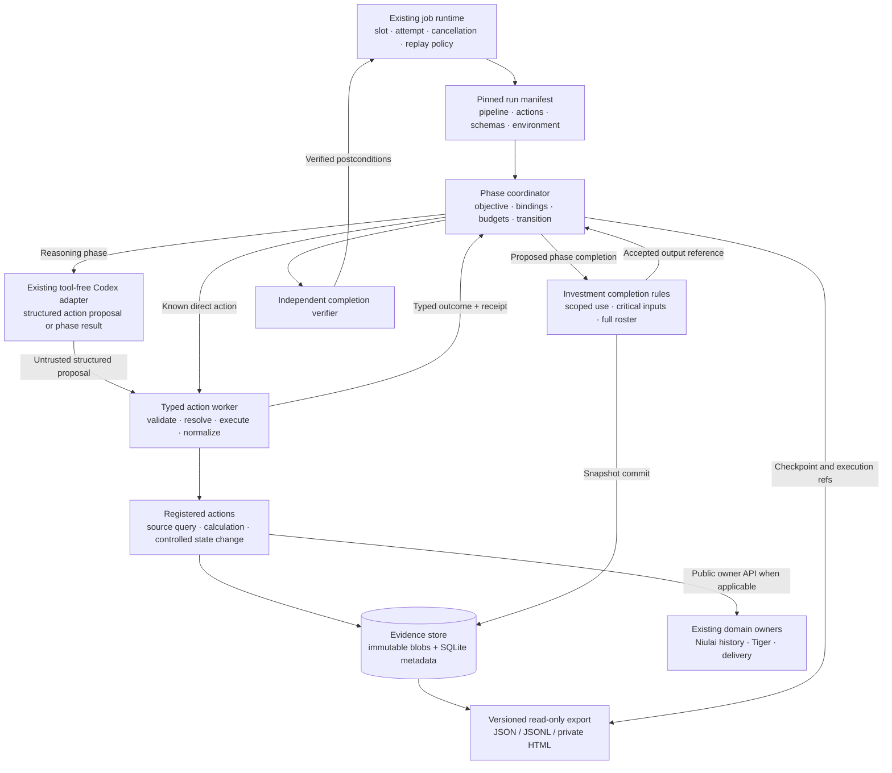
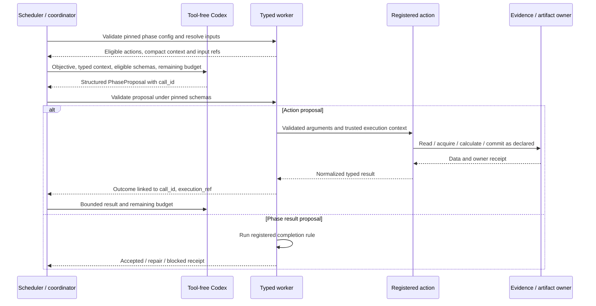
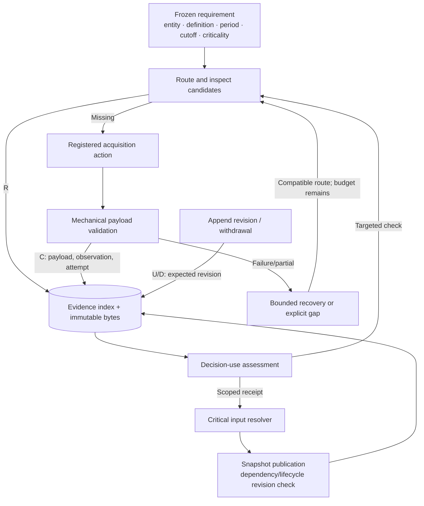

# Evidence CRUD, versioned actions and configurable investment phases

Implementation update, 2026-10-31: a scoped foreground evidence/action pilot is
implemented and has passed component and real scheduled-runtime checks. See
[the progress record](evidence-actions-pipeline-progress.md) for exact delivered
scope and remaining release/resume/provider work. The target design below is
retained; it is not a claim that every proposed layer is complete.

Status: proposed implementation plan, based on a read-only repository audit on 2026-10-30. This document does not activate configuration or claim the proposed runtime is implemented. The only changes in this design task are documentation and ignored mentor working records.

**Decision and intended gain**

Build one application-controlled research path around the existing Codex CLI, source adapters and investment validators. Its unit of execution is a phase with an objective, typed inputs, eligible actions, typed outputs and a completion rule. Its unit of reusable work is a versioned action. Its durable evidence is an immutable observation with provenance; permission to use it is a separate claim-scoped receipt.

The expected gains are fewer malformed handoffs, repeated retrievals, silent unit/version changes and unsupported phase transitions. Better reasoning depth and fewer unsupported investment conclusions are hypotheses to evaluate, not consequences established by typed JSON alone. Research quality remains separate from demonstrated investment alpha.

The MVP supplies evidence/snapshot CRUD, reviewed versioned actions, one configurable ordered research pipeline, bounded freshness/conflict resolution, and a private read-only run report. It reuses the existing scheduler, model authentication owner and domain adapters. A few registered functions, JSON schemas, manifests, immutable files and a local SQLite index are sufficient for this scope.

**1. What the repository actually provides**

| Current component | Verified responsibility | Reuse or small change |
| --- | --- | --- |
| [shared/job_runtime/model.py](../../shared/job_runtime/model.py) | Bounded tool-free Codex CLI execution; real completion/thread/usage parsing; private authentication-home lock; optional `--output-schema` | Reuse for reasoning. Add independent local schema validation in the typed worker; current local handling only JSON-parses schema output. |
| [shared/job_runtime/service.py](../../shared/job_runtime/service.py) | Readiness/business dispatch, cancellation and trusted completion adapters | Add one explicit pipeline branch and preserve mandatory independent completion verification. |
| [shared/job_runtime/engine.py](../../shared/job_runtime/engine.py) | Durable job/slot/attempt claims, replay safety and unknown-outcome fences | Retain scheduling and job ownership here. |
| [shared/job_runtime/host.py](../../shared/job_runtime/host.py), [deployment runbook](../deployment/job-runtime.md) | Explicit interpreter, conservative environment, workspace-local service state | Preserve the stdlib scheduler; use the research environment for typed validation/actions. |
| [niulai-runtime/README.md](../../niulai-runtime/README.md) | Maintained configuration/admission, report compatibility and delivery boundaries around the migration snapshot | Keep domain ownership. No production sender cutover is part of this MVP. |
| [niulai_runtime/job_adapter.py](../../niulai-runtime/niulai_runtime/job_adapter.py) | Bounded job-local Python subprocess pattern | Reuse the pattern for a typed research worker. |
| [shared/tiger/](../../shared/tiger/README.md) | Broker credential lifecycle, remote lease/checkpoint and query owner | Future registered read action delegates here; the generic executor never acquires a second credential owner. |
| [shared/research_sources/](../../shared/research_sources/README.md) | Versioned arXiv/document retrieval, OpenAlex discovery, bounded passages, hashed receipts and contained paths | Wrap the existing public functions; add observation CRUD and consistent retrieval outcomes. |
| [investment/research/](../../investment/research/README.md) | Frozen requirement roster, source capability routing, coverage validation, maintained finalization/completion | Preserve the completion façade; add scoped use receipts and an explicit pilot scope. |
| [ui/AGENTS.md](../../ui/AGENTS.md) | UI guidance and a synthetic verification fixture | Use its local test tools. The fixture is not the investment application. |
| [shared/job_runtime/proof.py](../../shared/job_runtime/proof.py) | Escaped private HTML/JSON rendered from durable execution evidence | Reuse the reporting pattern, with research-specific content and assertions. |

The preserved scripts at `niulai/skills/investment-research-financial-services/references/niulai-workflow/scripts/` provide useful deterministic components: `evidence_crosscheck.calculate`, `research_resolution.decision_metrics`, critical-data checks and revisioned research-store patterns. Their presence does not establish that every current path invokes them. `valuation_evidence.py` is an evidence-coverage validator; no general DCF calculator was established by this audit.

The inspected maintained execution path has no established LangSmith, Pydantic or Agents SDK integration. `jsonschema==4.25.1` and `rfc3339-validator==0.1.4` are already pinned in the research environment. PyYAML appears in optional mentor tooling, not the production phase execution path. Use JSON configuration and the existing validator dependencies initially.

Two observed source issues belong in the first storage patch: `artifacts.save()` exposes the final filename before finishing the write, and the arXiv file lock has no bounded acquisition wait. Repair these before advertising concurrent CRUD.

**2. Architecture and ownership**



Keep application control in code. The model proposes calls, assumptions and conclusions; it cannot authorize itself to mutate a frozen requirement, approve its own verification receipt or declare durable completion.

Ownership remains explicit:

- Shared action executor: catalog resolution, schema enforcement, approved code, execution limits and execution receipts.
- Shared evidence owner: raw/extracted bytes, observations/revisions, mutation idempotency, acquisition attempts, due-check metadata and atomic snapshot dependency checks.
- Investment phase runner: economic definitions, criticality, source compatibility, assumptions, claim support and completion rules.
- Job runtime: actual scheduling, model authentication serialization, job retries and unknown-job fences.
- Niulai/Tiger/delivery: existing domain state and external-effect protocols.
- Mentor/tuning: evaluation and improvement decisions outside production phase state.

The action catalog references provider capabilities in the existing source registry. Do not copy the provider coverage rules into a second competing router.

**Source coverage clarification, 2026-10-31: MVP scope and return on effort**

The MVP must distinguish usable retrieval from claim support. Most of the mechanisms below were already covered by the action, evidence and gate contracts; this checklist makes source-specific acceptance explicit.

| Gap | MVP commitment | Effort control and expected return |
| --- | --- | --- |
| Profile/catalog/adapter disagreement | Check requested hosts, access level, formats and capability against actual adapter policy before proposing a route; record exclusion reasons | Small static check prevents predictable failed calls. The business-economics profile currently lists Federal Reserve/FDIC hosts absent from the fetch allowlist; mark those routes unsupported until deliberately implemented/tested, while retaining compatible SEC routes. |
| Returned content lacks the requested information | For the selected pilot capability, validate entity, metric/document identity, definition, period, units/basis and source location as applicable; expose missing fields/coverage | Narrow contract and reviewed fixture; avoid a universal financial extractor. |
| Inconsistent retrieval status | Typed usable/partial/empty/error classification, normalized into the shared action outcome | Reuse adapter checks and common envelopes; successful transport alone cannot complete coverage. |
| Uncertain readiness and recovery | Per-capability configuration/test scope, last observed result and cooldown; bounded compatible fallback and total deadline | Use actual calls and existing limits; no periodic all-provider probing or new health service. |
| Stale/conflicting data | Due checks, critical-read expiry, version-aware updates and bounded resolution | Existing packages B/E; fake-clock and replay verification cover most cases cheaply. |
| Correct bytes but unsupported claim | Exact passage/model bindings plus scoped substantive review, including source independence and applicability | Existing gates plus a few source-grounded cases; schema validity cannot establish truth. |
| Broad document/financial coverage | Explicitly report unsupported PDFs, tables, hosts or metrics | General PDF/table extraction, new provider integrations and specialist datasets are deferred until a material gap justifies their development and live-verification cost. |

Package A produces one small capability acceptance matrix:

```text
requirement -> compatible endpoint -> expected payload/coverage
-> retrieval checks -> claim-use checks -> tested scope -> fallback
```

Record configuration compatibility, observed retrieval outcome and decision-use eligibility separately. A successful NVIDIA guide fetch establishes neither SEC extraction readiness nor general issuer coverage. Additional source names do not count as additional usable capabilities.

Cover a financial-fact example and a technical-document example with existing reviewed captures where available. Keep the initial live requirement to one coherent source-to-fact-to-calculation path, reusing prior technical-route evidence with its original scope explicitly stated. A second live route is justified only if an unresolved adapter-specific risk could change acceptance. This clarification adds source-specific checks to packages A/C/E and existing test families; it does not add a separate workstream or broaden provider onboarding.

**3. The implementable phase contract**

```text
PhaseSpecV1
  phase_id, objective, mode: direct_action | agent
  input_bindings, output_schema_ref
  action_ref OR permitted_action_refs / required_capabilities
  completion_rule_id, policy_ref
  deadline, action/model/repair budgets

PhaseProposalV1
  phase_id, call_id
  kind: call_action | propose_result | report_gap
  typed payload for the selected kind

PhaseReceiptV1                    # application-produced
  phase_id, input_manifest_ref, output_refs
  evidence_refs, calculation_refs, unresolved_requirements
  disposition: accepted | repair_needed | blocked
  completion_rule_version, reason_codes, execution_refs
```

The provider-facing response schema may need a simpler compatible envelope; the local worker must still validate the complete discriminated union. A model's proposed status is input to the gate. Only application code produces an accepted phase receipt.

Every phase definition must answer five questions: what result is sought, what exact inputs are available, which actions can run, what typed output is required, and what evidence permits completion.

The broader company-review target can use these phases:

| Phase | Objective | Typed inputs | Available actions | Typed outputs | Completion rule |
| --- | --- | --- | --- | --- | --- |
| Evidence | Obtain the model's specified facts for the required entity/definitions/periods | Frozen requirements, cutoff, prior snapshot | Candidate lookup, source acquisition, bounded reads | `EvidenceBundleV1` plus gaps | Required coverage and provenance represented; critical use eligibility separately resolved |
| Assumptions | State material future parameters and ranges, separating observations from estimates | Evidence bundle, model-input definition | Evidence reads, existing scenario helpers where suitable | `AssumptionSetV1` | IDs, units, ranges, supporting/challenging evidence and unresolved inputs explicit |
| Calculation | Compute the declared model and sensitivities from exact inputs | Pinned assumptions and applicable evidence-use receipts | Registered calculator | `CalculationResultV1` | Known-answer/invariant checks and exact input bindings; critical dependencies eligible |
| Interpretation | Identify material drivers, counterevidence and changes to assumptions | Calculation, assumptions, evidence | Bounded evidence reads and registered recalculation | `DecisionDraftV1` | Every material assertion links to inputs/evidence; changed assumptions have matching recalculation |
| Finalization | Publish the allowed scoped conclusion and its dependencies | Draft, full requirement roster, manifests | Application-owned snapshot commit; maintained investment validators | `SnapshotRefV1`, completion receipt | Current dependency/lifecycle stamps and required domain postconditions pass |

This table is the target contract, not evidence that a valuation calculator exists. The first pipeline is a narrower evidence-resolution pilot using existing acquisition and numeric-comparison code. A missing calculator becomes a capability-gap record; it does not justify inventing a financial result.

Use listed phase order. Validate field-path bindings at configuration load; reject unknown fields, forward references, cycles and incompatible declared types. Bind output references directly. A later phase receives the same calculation artifact rather than a paraphrased reconstruction.

Subpipelines initially use a named composition function or included phase list with the parent's budget. General DAG scheduling and a pipeline language are later decisions.

**4. The actual Codex interaction**

The current CLI adapter disables tools and rejects unexpected tool activity. It cannot transparently intercept native CLI tool calls. Implement an application-controlled structured-action loop:



These are application-level call IDs and continuations, not a claim that the existing CLI uses a provider's native function-call/result protocol. Because calls are ephemeral, carry compact phase state and references explicitly. Limit repeated model starts; mandatory known calculations run directly.

Use a stable logical run identity tied to the scheduled slot or explicit research request, separate from the scheduler attempt ID. Persist the resolved run manifest and next action intent before dispatch. A resumed attempt keeps those pins and operation/request IDs, reconciles any committed owner receipt, and accounts for earlier attempts in the remaining budget. It must not silently resolve newer releases or reset retry budgets. Intentional new work receives a new operation identity; altered content under an old request ID conflicts.

A native SDK can replace this model adapter later if measured latency/context-reconstruction cost warrants it. The action and phase contracts should survive that replacement.

**5. A versatile action contract with bounded authority**

A script is a registered action implementation: a Python function, reviewed subprocess, existing adapter call or controlled state transition. It does not imply arbitrary shell or Python execution.

```text
ActionDescriptorV1
  action_id, release_version, implementation_kind
  handler_registration_id
  input_schema_ref, output_schema_ref
  capability_refs, coverage_limits
  effects[], retry_owner, resource_policy
  release_manifest_ref, lifecycle

ActionRequestV1
  action_ref                       # exact resolved release
  request_id, run_id, phase_id, call_id, operation_id
  arguments, input_refs
  expected_revisions?              # state-write preconditions
  deadline, remaining_budget

ActionOutcomeV1[T]
  success: data T, provenance_refs, execution_ref
  partial: data T, missing_coverage, execution_ref
  failure: code, field_errors?, recovery, effect_state, execution_ref

effect_state: not_started | committed | unknown
```

Keep execution status separate from domain findings. A numeric comparison that correctly returns `disagreement` executed successfully. Its phase may need resolution; the runtime must not retry disagreement as a transport error.

| Effect | Examples | Recovery owner |
| --- | --- | --- |
| Pure computation | Numeric comparison; supplied-input scenario arithmetic | Reuse exact input/release results or rerun within budget |
| Remote read | Public document/query | Existing source adapter/portal owns eligible transport retries |
| Local state write | Evidence create/revise/withdraw; snapshot commit | Evidence transaction, request fingerprint and expected revisions |
| External effect | Delivery or broker mutation; credential lifecycle has its own owner | Existing domain fence/reconciliation; excluded from the initial research pilot |

Composite acquisition declares remote read plus local persistence. Its storage failure can retry the local commit without refetching the source. The generic wrapper does not multiply the portal's internal retry count.

Initial useful wrappers:

1. `evidence.acquire_document@1`: existing exact-version arXiv or allowlisted document fetch plus observation storage.
2. `evidence.compare_numeric@1`: preserved `evidence_crosscheck.calculate` executed with explicit units, periods, lineage and predeclared tolerances.

Add narrow store operations such as `evidence.read`, `revise`, `withdraw` and application-owned `snapshot.commit` through the same contract. They are functions, not separate servers/processes for each CRUD verb. The model may propose a candidate observation; it cannot manufacture an approved decision-use receipt.

**6. Enforce types at real boundaries**

The typed worker performs this sequence:

1. Decode bounded JSON; reject duplicate keys and non-finite numbers.
2. Resolve action, schema, gate and policy through application-owned registration dictionaries.
3. Validate argument schemas with closed object fields, bounded collections and explicit nullable fields.
4. Resolve contained input references; verify hashes, schema versions and content types, then validate contents.
5. Apply only named versioned normalizers. Preserve original units/values and conversion provenance.
6. Execute within the remaining deadline and declared effect policy.
7. Validate normalized output and output artifacts before publishing a success receipt.
8. Return a result linked to the original call ID and emit the authoritative execution record.

Use the existing JSON Schema dependency, explicit format checking and a local-only schema registry. Date-time formats are not automatically enforced merely by writing `format` in a schema. Reject remote schema loading and unknown schema IDs. [python-jsonschema validation documentation](https://python-jsonschema.readthedocs.io/en/stable/validate/)

Use the existing decimal-string convention for financial quantities where appropriate. Treat missing/unknown units as unresolved; do not infer them from magnitude. Type names alone cannot establish comparability or truth.

Model arguments cannot supply arbitrary import paths, executables, shell strings, credential values, unrestricted URLs or output directories. Trusted execution context supplies workspace roots, approved release, owner references, deadlines and mutation permissions.

Application code generates durable request IDs and binds untrusted call IDs to the current phase. The model cannot override the run's budget, deadline, resolved release or expected requirement version by placing different values in its arguments.

**7. Versioned script CRUD and reproducibility**

Use ordinary Git development plus a small release manifest. Semantic version labels describe contract compatibility, including units, definitions and field meaning. Released contents remain immutable. [Semantic Versioning](https://semver.org/)

| Operation | MVP behavior |
| --- | --- |
| Create | Add reviewed implementation, schema, catalog entry and focused regression cases |
| Read | Inspect description, schema, effect policy, release manifest and test evidence |
| Update | Publish another release; compare with the previous version on the originating case and existing valid cases |
| Delete | Retire from new discovery/bindings; retain historical release bytes and execution references |

Resolve releases once at run start. Record action ID/version, source revision, pipeline/config digest, schema/normalizer versions and environment identity. Catalog updates cannot silently upgrade in-flight runs. A separately blocked defective release stops new execution with an explicit reason, even when an older manifest names it; history remains readable.

Git HEAD alone is insufficient in this dirty workspace. An execution release manifest must cover the entrypoint, transitive local helpers and schemas, dependency specification/fingerprint and interpreter identity. Freeze the selected files into a workspace-local release bundle and verify its digest before use. Do not snapshot private state or copy the whole repository.

There is one necessary staging adjustment: current artifact code derives `ROOT` from `__file__`. Copying it into a release bundle would change that root. Introduce an explicit trusted workspace-path context for staged execution and keep existing call sites behind a compatibility façade. Legacy dependency paths must resolve to the approved staged public scripts, not accidental working-tree imports. Test this relocation before claiming immutable execution.

The manifest should state the strength of environment reproduction honestly. Top-level package pins and an installed-distribution fingerprint are useful, but are not a complete cross-platform hash lock. No automatic package installation occurs during a research run.

Reviewed release bundles are a cooperative versioning boundary. They do not provide adversarial isolation from the workspace owner. Agent-authored drafts stay outside the production catalog until selected, tested and published through the engineering workflow.

**8. Evidence CRUD shares the executor and receipts**



Physical storage stays small: immutable raw/extracted/receipt/manifest files plus one local evidence metadata index. Index the observations/revisions, idempotent mutation requests, acquisition attempts, scoped use dependencies, requirement due checks and committed events needed by the first workflow. Keep job state in the current engine and sequential phase checkpoints under the existing attempt directory; do not create a second general workflow database.

Evidence CRUD invariants:

- Create is idempotent by request ID and canonical fingerprint. Identical replay returns the prior receipt; different content conflicts.
- Reads return candidates and limitations. Critical calculations request exact observation and lifecycle revisions.
- Updates append a correction/source/extraction revision using an expected-head check.
- Withdrawal appends a tombstone and reason; exclude it from new ordinary use and retain audit reads.
- Deduplicate identical bytes while preserving separate acquisitions and upstream lineage.
- Re-extraction creates a versioned derivation without requiring another remote request.
- Stored observations have no universal `verified=true`. Use receipts bind evidence to a claim, cutoff, method and applicable model context.

Reuse the legacy research store's append/revision/idempotency pattern, while retaining its claim-oriented records as a history destination. Raw transport responses should not be forced into its claim/ticker schema.

For atomic publication, write and flush a temporary blob, publish it atomically, then commit metadata and its required event. A precommit crash may leave an orphan blob; it must not leave an indexed reference to incomplete bytes. A postcommit lost response is reconciled by request ID. Physical deletion and reference-aware garbage collection are deferred.

Use one-host bounded fetch-key advisory locks, then recheck cache after acquisition. Never delete/replace lock files during coordination. Keep HTTP outside database write transactions. Short write transactions use bounded contention handling and expected revisions. Begin with the existing/default journal approach; evaluate WAL only after runtime-version checks and observed contention justify it.

Exactly-once committed local mutations are supported by idempotency. Remote GETs, provider charges and unobserved external outcomes may repeat or remain unknown after a crash.

**9. Lightweight staleness and conflict resolution**

Keep freshness per requirement context, not one flag per ticker. A small due-check record contains requirement/contract identity, current observation/use refs, next check, hard decision deadline, state, bounded attempts and generation. Derive expiry from the versioned requirement policy where possible rather than storing contradictory duplicate fields.

```text
classify(requirement, observations, now)
  -> eligible | qualified | needs_check | blocked + reason codes

schedule_check(requirement, outcome)
  -> persisted next_check_at + resume condition + generation

resolve(requirement, candidates, remaining_budget)
  -> supported use | reviewed bounds | restricted conclusion
```

Distinguish `source_time/source_revision`, `last_checked_at`, `next_check_at`, critical-use expiry and the decision deadline. Successful retrieval of unchanged old data advances last-check time without rejuvenating the observation or extending the deadline.

Use manual, source-class policies first: live observations follow their timestamp; periodic facts follow required periods and expected publication; exact historical versions remain usable for their historical question. Unknown availability cannot be backdated. Latest/current and exact-version requests have different contracts.

Drain due work through ordinary research entry points and the existing scheduler. Query due rows by approaching deadline; enforce provider limits and fetch locks. No new scheduler or continuously running refresh service is required. Recheck freshness/conflicts at critical read and finalization so missed scheduled work cannot leave expired inputs eligible forever.

Version promotion is per source series. Order by native revision rules, never retrieval completion time. Archive older late responses without moving the head backwards. Unknown ordering or changed bytes under the same claimed version creates an unresolved candidate/conflict. Expected revisions and task generations stop superseded workers changing newer state.

Conflict resolution is a short ordered routine: check comparability; apply explicit conversions; inspect eligible revisions; compare using predeclared tolerances; make a targeted additional attempt when material; then support, bound or restrict by the deadline. Distinct definitions/periods stay separate. Conflicting economic observations are preserved and never silently averaged.

Permanent access failures wait for a relevant configuration/access change. Transient failures use bounded recovery. The timer makes work visible; it does not establish upstream freshness or guarantee refresh while the host is asleep or the provider unavailable.

**10. Three enforcement boundaries and finalization**

| Boundary | Mechanical enforcement | Semantic owner |
| --- | --- | --- |
| Before execution | Registered eligible action, exact release, valid arguments, intact referenced inputs, permission/preconditions and budget | Phase policy determines which capability is needed |
| After execution | Payload/response status, schema, deliberate unit normalization, output hashes and calculation invariants | Decision engine determines relevance, independence, comparability and support |
| Before phase/snapshot completion | Required artifacts, exact bindings, complete frozen roster, applicable receipts, current lifecycle stamps and unresolved critical dependencies | Registered investment gate and substantive review determine allowed conclusion |

Raw responses may be archived immediately. A partial or error response cannot become complete coverage merely because it is nonempty or returned HTTP 200. Preserve reported facts, management guidance, estimates and assumptions as distinct kinds.

Every critical calculation input resolves to an applicable observation/use receipt or an explicitly reviewed assumption. The complete input inventory and frozen requirement roster are checked again at finalization. A retrieval failure cannot remove a requirement or lower criticality. Scope changes create a new reviewed requirement snapshot.

The snapshot commit pins observation and lifecycle revisions and checks them transactionally. A withdrawal between review and commit forces reassessment. Later withdrawals affect future use and annotate history without rewriting the historical snapshot.

The evidence index, legacy research history, scheduler state and delivery outbox have different owners. Publish immutable references, apply idempotent history projections and keep completion pending until required postconditions hold. There is no claimed cross-database transaction.

Keep `investment.research.pipeline.finalize/complete` as maintained full-research seams. A pilot success has scope `evidence_resolution_pilot`; it must not satisfy or weaken full-company/NVDA coverage rules. Test that a pilot bundle fails a full-research completion attempt.

Enforcement applies to the maintained executor and tested scheduler path. Existing direct legacy invocation and a fully privileged workspace user remain outside an adversarial isolation guarantee.

**11. Worker, scheduler and security refactor**

Keep `.job-runtime/.venv` stdlib-only. Add an explicit pipeline branch to `service.dispatcher`, with a thin coordinator supervising model calls and a controlled typed worker under the existing research Python environment.

Validate pipeline executor configuration centrally, including approved interpreter, pipeline/catalog references and completion verifier. Derive replay eligibility from the permitted effects and owner protocols. A configuration flag cannot make an unreconciled external effect safe to repeat.

The worker handles schema validation, action dispatch, domain gates and canonical output publication. The coordinator handles existing `run_codex`, cancellation, phase iteration, remaining budgets and job-facing status. Validate the worker protocol as well as action outputs. Pipeline-only profile settings must be separated before invoking the model's strict profile parser.

Keep model invocation in the supervising coordinator initially. `run_codex()` starts its own process group; moving it beneath another worker without explicit descendant cleanup would create a cancellation hazard. Test shutdown during model execution and during source/worker execution independently.

Do not implement the entire pipeline as a preparation adapter that returns `status`: the current dispatcher immediately returns that result before its completion-adapter branch. Use an explicit pipeline completion verifier, or extract a small shared completion helper, so scheduler success follows independent postconditions.

Reviewed calculation workers receive pinned code, scoped input references and a fresh private output directory. Use argument lists, sanitized environment, bounded stdin/stdout, wall-clock timeout and process cleanup. Resource enforcement must report which limits are actually supported/tested on the current host. Do not advertise a security sandbox or OS network isolation from a controlled working directory/subprocess alone.

The MVP offers reviewed registered tools. General code execution or agent-edited executable code requires a separately tested filesystem/network/process sandbox before joining the production path. Retrieval credentials and external effects stay in their existing owners; generic calculation workers receive no broker/authentication state.

**12. Minimal configurable pipeline example**

This illustrates the proposed JSON configuration shape. All IDs resolve to approved code/schema/release registrations; it is not an active configuration.

```json
{
  "schema_version": 1,
  "pipeline_id": "evidence_resolution_pilot",
  "pipeline_version": "0.1.0",
  "completion_scope": "evidence_resolution_pilot",
  "phases": [
    {
      "phase_id": "evidence",
      "objective": "Acquire the specified source and preserve exact provenance and missing coverage.",
      "mode": "direct_action",
      "action": "evidence.acquire_document@1",
      "inputs": {"requirement_ref": "request.requirement_ref"},
      "output_schema": "EvidenceBundleV1",
      "completion_rule": "pilot_evidence_coverage_v1"
    },
    {
      "phase_id": "comparison",
      "objective": "Compare the declared observations under their exact definitions and tolerances.",
      "mode": "direct_action",
      "action": "evidence.compare_numeric@1",
      "inputs": {"comparison_request_ref": "request.comparison_request_ref"},
      "output_schema": "NumericComparisonResultV1",
      "completion_rule": "comparison_integrity_v1"
    },
    {
      "phase_id": "interpretation",
      "objective": "Explain the permitted use, material disagreement and unresolved requirements using the exact evidence and comparison.",
      "mode": "agent",
      "inputs": {
        "evidence_ref": "evidence.output_ref",
        "comparison_ref": "comparison.output_ref"
      },
      "permitted_actions": ["evidence.read@1"],
      "output_schema": "EvidenceDecisionDraftV1",
      "completion_rule": "pilot_decision_coverage_v1"
    }
  ],
  "finalization_rule": "pilot_snapshot_commit_v1",
  "budget_policy": "research_pilot_bounded_v1"
}
```

The initial comparison request may use reviewed captured public observations. Label that portion replay evidence. A live document fetch does not turn unrelated fixture calculations into live financial analysis. Package A must identify one supported fact, inspect its extraction method and references, and demonstrate that its exact observation versions can feed the comparison before runner work begins. Use that same source for the eventual live refresh where feasible. If the selected source needs a broad new parser, choose a better-supported pilot input within the discovery budget and record the capability gap; do not silently add a parser project.

At run/phase input binding, reject a numeric request whose provenance is unrelated to the requirement being claimed. An intentionally separate component-check calculation must be labeled as such and cannot support the pilot's financial conclusion. Captured-data component tests remain useful while selecting the coherent live pilot; they cannot satisfy the stronger source-to-calculation acceptance claim.

The initial budget policy should allow only the turns/actions needed for this path and one bounded repair where justified. Freeze numeric call/time ceilings after checking the selected adapters' mandatory calls and existing model-profile constraints, before candidate comparisons. Carry one aggregate budget through fallback and substeps. Unknown token/cost telemetry remains unknown; call/deadline limits are enforceable even when billed cost is unavailable.

**13. Observability for runtime, debugging and evaluation**

Use one versioned event envelope and compact requirement/phase receipts:

```text
schema_version, event_id, store_sequence, occurred_at, event_type
run_id, job_attempt_id, phase_id, operation_id, parent_operation_id
requirement_ref, request_id, call_id, fetch_attempt_id
action_release_ref / capability_id
outcome, reason_code, artifact_refs
duration_ms?, observed_usage?
```

Reuse actual scheduler attempt and CLI thread identities. A single job attempt can contain many model turns, action executions and outbound attempts. Record requested versus observed model identity separately, following the existing adapter's convention.

Required state-change events commit with their metadata changes. Record acquisition intent before dispatch and preserve interrupted/unknown outcomes after a crash. Optional portal callbacks and timing details are bounded and nonthrowing. Current portal log callbacks are invoked directly; do not wire a throwing database writer into them.

Record route/cache outcomes, actual attempts and recovery reasons, observation revisions/withdrawals, use-assessment outcomes, phase gates, capability gaps and snapshot commits. A cache hit means a candidate was found; HTTP success means a response was received. Neither event establishes completed coverage.

Expose `inspect`, cursor-based `events`, and `export_run`. Export committed events using store identity plus sequence; consumers resume/deduplicate by event ID. Avoid many producers appending to one shared JSONL file. JSONL and HTML are reproducible views; stored owner receipts remain authoritative.

```text
RunViewV1
  schema_version, run_id, pipeline_id/version, run_manifest_ref
  generated_at, information_cutoff, execution_status, completion_scope
  phase_results[], requirement_results[], action_execution_refs[]
  artifact_refs[], observed_usage?, acceptance_status?
```

The export must answer: why a requirement is unresolved; which retries/fallbacks actually ran; whether cache reuse avoided a call; which inputs depend on a withdrawn observation; whether sources share lineage; and whether a completed conclusion has an unresolved critical dependency.

Keep three status axes explicit: execution status, coverage/conclusion status, and runtime acceptance status. A workflow can successfully produce a correctly restricted gap report; that does not establish successful retrieval or a supported critical conclusion. An unverified scheduled acceptance remains unverified even when component tests pass.

Log stable IDs, safe reason codes, counts, timings and references. Keep raw payloads/private prompts in designated private artifacts. Exclude credentials, account identifiers, URL tokens and unrestricted exceptions from exports, including nested errors. Preserve compact provenance with its snapshot; cap optional debug retention. Defer deletion of referenced evidence until reference-aware retention exists.

**14. Light observability UI**

Generate one private standalone HTML report from `RunViewV1`, following the existing proof renderer pattern. Keep the renderer beside the new runtime's read-only export code. The synthetic `ui/verification` fixture remains a tool/skill test fixture.

```text
Evidence resolution pilot                         Restricted
Run / pipeline version / cutoff / generated time / acceptance state

Phase             Objective           Action version   Result and reason
Evidence          Obtain ...          acquire@...      Partial: missing period
Comparison        Compare ...         compare@...      Incompatible definitions
Interpretation    Explain ...         model profile    Critical claim restricted
  [Expand inputs, outputs, attempts and gate receipt]

Evidence issues
Requirement | Source period/version | Last checked | Next check | Affected inputs

Observed usage: calls / elapsed time / tokens / cost or Unavailable
```

Use readable system typography, a neutral surface, semantic table structure and native disclosure controls. Emphasize the issue/reason column. Distinguish partial, restricted, failed and unknown with text plus restrained semantic color. The generation timestamp makes the report's snapshot nature visible.

For narrow screens use stacked rows or a labeled, contained scrolling table. Provide keyboard focus and descriptive links; verify long identifiers, empty results and mixed outcomes. Escape source-derived text and constrain links to approved artifact references. A browser does not open SQLite or obtain credentials.

No mutation/retry controls, polling, chart package, visual workflow editor, hosted deployment or frontend application is needed for the first report. Use the workspace-local UI tooling for two viewport checks, keyboard use and injection/error-state verification. Actual rendered checks occur during implementation; this design task supplies a wireframe, not a completed UI.

**15. Capability needs feed the engineering workflow**

Emit a `capability_gap` or costly-workaround event with capability, phase, contract, failure mode, trace reference, impact and proposed next action. Deduplicate across distinct runs by capability + failure mode + contract. Multiple retries in one run are one occurrence of a need.

Triage in this order: fix discovery/input/configuration when a suitable tool exists; repair a wrong existing implementation; extend a closely related operation; compose existing actions; select a new script only for demonstrated incremental value. Weak conclusions with correct calculations belong to phase/evidence/evaluation improvement.

Selected changes enter the existing Git/task workflow. Their originating trace becomes a regression case. Script drafts do not automatically build/publish themselves; no script-construction queue is part of this MVP.

**16. Minimal refactor map**

The following paths are proposed implementation locations, not an instruction to create every file upfront:

| Area | Proposed change | Effort and containment |
| --- | --- | --- |
| `shared/actions/` | Contracts/schema registry, catalog/manifest resolution, controlled worker protocol and dispatch | Small module set; no provider SDK or domain truth logic |
| `shared/research_sources/artifacts.py` | Atomic publication and explicit trusted path context for release staging | Focused foundational change; keep compatibility façade |
| `shared/research_sources/store.py` | Observation CRUD, idempotency, revisions/lifecycle, attempts, due checks and committed events | Medium; highest persistent-state safety value |
| `shared/research_sources/` adapters | Normalize outcomes, bound total wait, propagate IDs; reuse existing provider calls | Incremental; avoid broad new source onboarding |
| `investment/research/` | Phase schema/config, runner/gates, scoped use assessment and critical-input resolver | One ordered pilot; existing full-research gates retained |
| `shared/job_runtime/` | Thin stdlib pipeline coordinator/dispatch branch and mandatory completion verification | Additive; current readiness/business paths preserved |
| Export/report code | `RunViewV1`, event cursor/inspect/export and escaped static report | Small after receipt schema stabilizes |
| Component tests + `tuning/evals/` | Deterministic contract/state tests and source-grounded pipeline comparison | Reuse known-answer fixtures and existing validators |

Avoid editing `niulai/` or `niulai-private/`. Freeze necessary public legacy dependencies into the approved action bundle and adapt them through maintained wrappers. Do not refactor broker authentication, holdings calculations, production delivery or cloud ownership merely to demonstrate this research path.

**17. Implementation work packages and stopping points**

Each package has a concrete acceptance artifact; verification is included in its effort, not deferred as an unpriced final phase.

| Package | Objective and typed input | Output / completion rule | Relative effort |
| --- | --- | --- | --- |
| A: Contract and fixture freeze | Existing API shapes, selected public requirement and baseline traces | Approved schema/config/release drafts; source capability acceptance matrix and compatibility check; verified coherent source-to-fact-to-comparison input, frozen case manifest and budgets; runner work waits for this exit criterion | Small |
| B: Atomic evidence slice | Typed observation/mutation request | C/R/U/withdraw receipts; idempotent replay, expected-revision conflict and crash postconditions pass | Medium |
| C: Two action wrappers and releases | Existing source/numeric functions plus schemas | Pinned staged actions produce validated outcomes; source drift/relocation/retirement cases pass | Medium |
| D: Ordered phase execution | Pinned pilot config + input refs | Centrally validated pipeline executor configuration; direct actions and bounded model phase produce canonical checkpoints/receipts; wrong bindings and false completion blocked | Medium |
| E: Freshness and decision enforcement | Requirement policy + observations + clock | Persisted due checks, bounded resolver, critical-input checks and atomic lifecycle-dependent snapshot commit | Medium; uses B/D rather than a new service |
| F: Export and light report | Committed owner receipts/checkpoints | Valid `RunViewV1`, resumable events and truthful escaped HTML; rendered checks pass | Small |
| G: Matched evaluation and scheduled acceptance | Frozen candidate, fixtures/budgets and isolated acceptance allocation | Complete scoped evidence and verified configured-owner result notification under existing policy | Bounded live work; failures retained |

Begin with A, then B/C, then D/E, then F/G. One integrated narrow path should run before broad provider/model expansion. This is a dependency sequence, not a claim about elapsed days; package B/C safety and release staging are the main implementation uncertainty.

The MVP is complete only when all agreed CRUD operations work, the configured pilot runs through the registered executor, stale/conflicting critical inputs cannot silently advance, releases are pinned, and the exported/report view matches durable state. It need not implement a general company valuation engine to prove this infrastructure.

**18. Verification with controlled real-data effort**

Decision: whether the narrowly specified application-controlled pilot can replace its current ad hoc execution path. Hypothesis: typed actions, direct bindings and completion gates reduce malformed/unsupported advancement and redundant work at acceptable total cost. Rival explanation: apparent savings come from skipping required checking or accepting stale/incompatible inputs.

Freeze baseline/candidate code/config, cases, source captures, cutoffs, model profile and budgets before candidate results. Reused development examples remain development evidence. Do not inspect protected investment holdouts. Keep selection and entry behavior unchanged.

Eight parameterized scenario families provide the initial coverage:

| Family | Core variants | Independent oracle |
| --- | --- | --- |
| 1. Action contracts | Unknown action/version, invalid arguments, unknown units, malformed response | Worker dispatch counter and independently validated output; rejected requests have no execution effect |
| 2. Release and artifact binding | Missing/tampered refs, source drift, staged-root relocation, retire/block, in-flight pin | Actual bytes, manifest/dependency refs and resolved action identity |
| 3. Calculation and bindings | Known answers, different assumptions, incomparable units/periods, changed input without recalculation | Existing Decimal-based fixtures and exact input/output hashes |
| 4. Retrieval recovery | HTTP-200 error, empty/partial payload, timeout/429, permanent missing access | Controlled endpoint counter, actual attempt records and deadline checks |
| 5. Freshness/conflicts | Re-fetch old data, historical/current contrast, late old response, material/immaterial conflict, repeated postponement | Fake clock, explicit source versions and frozen tolerance/decision policy |
| 6. Persistence/concurrency | Concurrent identical create, request-ID misuse, stale expected revision, crash before/after commit, withdrawal | Real processes; independent DB/blob readback; no lost revisions or dangling references |
| 7. Phase completion/resume | Missing artifact, unresolved critical input, withdrawal during review, stale generation, cancellation, pilot/full-scope mismatch | Re-read roster/dependencies and publication stamps; explicit restricted/blocked status |
| 8. Observability/UI | Export failure, optional logger failure, missing mandatory receipt, synthetic secret, HTML injection, empty/mixed/long data | Export compared with state, secret scan and local rendered/keyboard checks |

These are families with small targeted cases, not eight giant scenarios. Test runner/grader cases alongside their component; keep cross-component outcome evaluation in `tuning/evals/`. Avoid building a new evaluation platform.

Verification ladder:

1. Fast replay: small captured public payloads, synthetic edge cases, fake clock and existing known-answer math. No live model/source calls for most cases.
2. Real local processes: concurrency, process death, cancellation, lock release, staged imports and response-loss reconciliation. Mocked exceptions alone are insufficient.
3. Small source-grounded review: inspect actual passages/units/periods and the legitimacy of claim support, bounds and exceptions. Review flags/citations are not truth oracles.
4. One live source slice: one existing capability, one concrete requirement and a cached reread. Use the same reviewed source/input where possible; do not expand to many issuers/providers.
5. One intended future-triggered scheduled Codex acceptance through the new branch, plus independent postcondition verification. A repaired implementation needs fresh evidence; retain every failed attempt.

Use virtual time for many freshness/publication cycles. It proves scheduling logic, not multi-day uptime. A short actual scheduled test establishes the selected runtime path; long endurance monitoring is deferred until operational need justifies its cost.

For a single source-to-calculation test, use one reported fact with a reviewed extraction and exact source passage, then compare/recalculate from its pinned version. Two parsers of the same filing may check extraction, but do not establish independent business corroboration. If the live route lacks that extraction capability, label the live acquisition and replay calculation separately and leave the stronger E2E claim unverified.

Report dimensions separately: unsupported critical use, unnecessary blocking, source support and uncertainty handling; duplicate effects, lost revisions and replay correctness; cache reuse and actual attempts; tokens/latency/charges where observed; and fixture/setup/review engineering effort. Cold/warm cache results are separate. Do not infer a reliability percentage or general hallucination/alpha gain from the smoke suite.

An observed false completion, unsupported critical calculation, lost revision, dangling committed reference or secret exposure rejects that version for the tested scope. Missing required evidence leaves acceptance inconclusive. Complete passing evidence supports only the declared path. Expand cases for observed failures or uncertainty that could change the decision.

**19. Runtime acceptance, deployment and rollback**

Follow [the existing acceptance contract](../deployment/runtime-acceptance.md) after implementation: record candidate/config/release fingerprints, actual future slot/attempt and Codex thread, timing, independently verified business postconditions, failures/partials, evidence paths and verified configured-owner email receipt. The functional pilot excludes broker mutations and business delivery; acceptance notification remains the separately owned reporting requirement.

The completion verifier rereads blobs, schemas, release/input hashes, exact requirement roster, use/lifecycle stamps and phase/snapshot receipts. An executor's `verified:true` or successful model sentence is insufficient. Keep the verifier outside the evaluated worker's editable inputs; describe actual runner isolation rather than claiming protection from instructions alone.

Keep new allocations/candidate configuration disabled until the scoped implementation and acceptance prerequisites are ready. Do not hot-add active MCP servers. Optional MCP exposure later can reuse the action schemas and normalized results; protocol annotations do not supply application authorization, retry safety or phase completion. The current MCP specification defines tool input/output schemas and structured content, which can carry this contract when needed. [MCP tools specification](https://modelcontextprotocol.io/specification/2026-07-28/server/tools)

Every setup change updates the appropriate component runbook, [local setup](../local-setup.md) and sanitized setup inventory, then runs setup-audit refresh/check. Preserve existing project-local environments and explicit interpreter paths; no global install, proxy/auth change or shell-profile edit is required.

Rollback disables the new pipeline allocation and restores the previously supported executor/config binding. Preserve new immutable evidence, release manifests and failed-run receipts. Do not downgrade schema by overwriting history or clear an unknown external-effect fence. A software rollback cannot reverse an external effect; its existing owner reconciles it.

**20. Deferred work and evidence that would justify it**

| Later addition | Trigger |
| --- | --- |
| Native model SDK tool loop | Measured CLI restart/context overhead materially harms the pilot |
| Broader valuation/model library | Selected recurring capability gap and a defined financial contract with known-answer cases |
| More providers/MCP servers | Unresolved material coverage with a verified compatible alternative and scoped adapter value |
| Sandbox/container execution | Agent-generated or editable executable code enters the runtime |
| General DAG/concurrent subpipelines | A real workflow cannot fit listed phases/small composition without costly serialization |
| Separate work queue/service | Existing job runtime cannot meet observed durable background/concurrent-work needs |
| Distributed ownership/database | Work must span hosts or measured local contention exceeds the single-host design |
| Adaptive refresh/publication prediction | Fixed source policies demonstrably overfetch or miss consequential releases |
| LangSmith/OpenTelemetry or live web UI | Export/report limitations materially hinder repeated debugging/evaluation |
| Reference-aware retention/GC | Storage growth becomes material and reference integrity can be preserved |

The immediate implementation decision is package A: freeze a coherent narrow pilot and its contracts/cases, then repair atomic artifact publication and implement the first CRUD transaction. All accepted deliverables remain in the plan; the MVP controls their breadth and verification cost.

**Review provenance and limits**

The orchestrator integrated three read-only reviews: current runtime/ownership audit, typed action/evidence design, and evaluation/observability/UI design. Source findings were checked against the maintained files linked above. Mentor development/supervision/evaluation guidance and frontend-design/UIUX/Impeccable guidance informed the plan; actual mentor/UI hook initialization was unverified and direct reads were used.

Protocol/validation references were checked by direct public HTTPS retrieval, not native GPT search. The supplied Anthropic engineering URL returned an HTTP redirect error in that bounded retrieval and is not used as supporting evidence here. No claim is made that native search connectivity recovered. Existing source checks and scheduled acceptance prove the earlier source-separation work only; they do not accept this proposed combined system.
