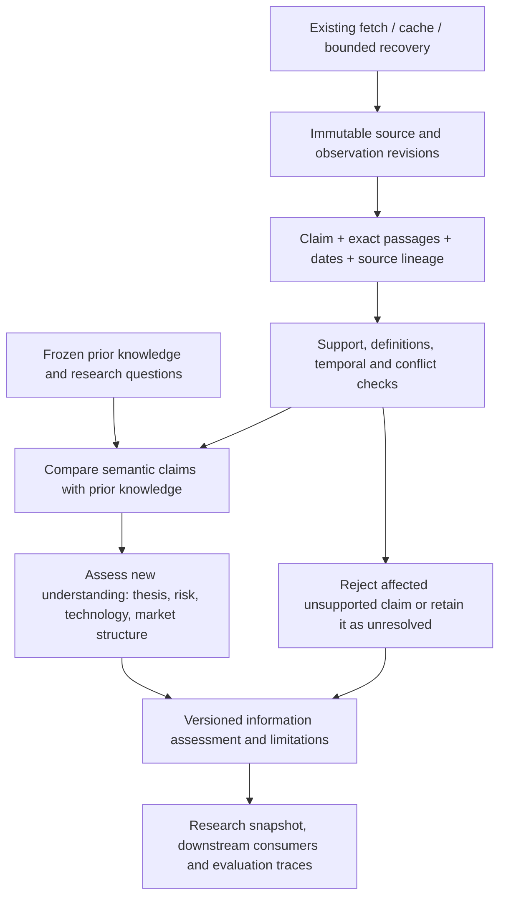

# Information quality and value evaluation architecture

Status: design proposal, 2026-10-31. No validator, source adapter, scheduling or
runtime integration is implemented by this document. Mentor evaluation-design,
evidence-and-overfitting, experiment-design and development-discipline procedures
inform the design. The target is **information quality and informational value**;
it does not score a change in action, position, valuation or realized profit.
Scope correction: atomic information assessment excludes priced-in analysis.
Combining information with price, valuation and market expectations belongs to a
later research layer, outside this contract, rubric and acceptance tests.

## Problem and scope

The SaaS A/B measured recent factual coverage, support and definition errors.
Those checks did not establish how much useful understanding either answer added.
A was the add-ons actually available: native web was not wired to the observation
cache, SaaS domains were outside the document adapter allowlist, and no transport
failure exercised retry/fallback. The old experiment and rubric remain unchanged.
Its formally rejected source-integrity result is not converted into a passing run.

Evaluate a claim or a small connected explanation, with source passages and a
dated comparison context. An article is a carrier, not the unit of value. One
article may contain several claims; ten syndicated articles may contain one claim.
An unfamiliar claim is not necessarily newly public, and public novelty is not
proof that the market failed to anticipate its economic implications.

The output answers: what is supported, how current it is for this question, what
it adds to existing knowledge, and how it improves understanding. An atomic item
can be a supported fact or a bounded explanation; it does not need a full company
analysis, price feed or valuation model.

## Architecture

The investment module owns the meaning of an assessment. Shared infrastructure
owns fetching and integrity, tuning owns cases/graders, and mentor owns supervision.
A research question does not require every insight category. The assessment can
be consumed later by combined research without depending on that layer.

## Two comparison contexts

1. **Prior research knowledge:** pin the research snapshot before examining the
   candidate. What did our existing claims and explanations already contain?
2. **Prior public information:** locate earlier disclosures and interpretations
   within a recorded search boundary. An unsuccessful search establishes only
   that an earlier disclosure was not located there.

The prior knowledge baseline needs an as-of timestamp. The analysis cutoff, the
claim's original availability and a document's latest revision are distinct.
Keep event time, first-public time, revision time, retrieval time and our
first-seen time, including time-zone and precision. Missing earlier sources mean
public originality is unresolved, rather than established by an empty search.

## Proposed reusable contract

`assess_information(item_ref, context_ref, policy_ref) -> InformationAssessmentV1`
is the proposed public interface, not an existing function. Its deterministic
validator and source-grounded semantic reviewer are separate: a valid schema is
not proof that the explanation is true.

Inputs:

- `item_ref`: entity, normalized claim(s), reported fact/guidance/estimate/
  interpretation type, exact passage references, observation revisions, source
  and upstream identity, units/definition/period where applicable, dates and limits.
- `context_ref`: frozen prior research claims, target questions, analysis cutoff,
  and bounded public-information search. No price, valuation or market-expectation
  input is required or used to grade atomic informational value.
- `policy_ref`: rubric/version, required comparisons, temporal rules, budget and
  applicable horizon. Do not make a full valuation model a required dependency.

Output sections:

| Section | Required contents |
| --- | --- |
| Identity | Assessment ID/version; exact input, baseline, policy and reviewer references |
| Quality | Source entailment, numerical/definition checks, temporal fitness, source lineage, contradictions and limits |
| Knowledge delta | Matched prior claim, before/after statements, change type and precise evidence for the difference |
| Contributions | Thesis/risk/technology/value-capture/market-structure explanations, premises, mechanism, competing explanation and limits |
| Outcome | Completed/partial/failed execution; supported/qualified/contradicted/unresolved claim judgments; missing dependencies |

Each contribution points to claim and passage IDs; an inference is explicitly an
inference. The author can propose a contribution but cannot certify its own
support. Unsupported reasoning remains visible without being admitted as a
supported insight. A false premise cannot be rescued by a persuasive explanation.

The smallest semantic delta vocabulary is `new_disclosure`, `new_measurement`,
`new_explanation`, `independent_confirmation`, `revision_or_correction`,
`definition_change`, `duplicate_or_rephrasing`, and `undetermined`. These are
baseline-relative annotations, not claims of universal originality. Source-chain
confirmation and semantic novelty remain separate fields.

For MVP duplicate candidates, compare entity, claim meaning, definition, period
and upstream identity, followed by source-grounded semantic review. Text hashing
or embedding distance alone cannot establish a new fact. Keep uncertain matches
as alternatives rather than silently merging them.

## Rubric: quality and contribution, separately

Use a small evidence-first vector. `unknown` and `not_applicable` are distinct from
zero. The labels below are development anchors to calibrate, not validated scales
or equal-interval measurements; do not sum them into a universal quality score.

| Dimension | 0 | 1 | 2 | 3 |
| --- | --- | --- | --- | --- |
| Source support | Contradicted or unsupported material claim | Relevant carrier but weak/partial support | Direct claim-level support | Appropriate support checked against revisions, conflicts and scope limits |
| Precision | Materially conflated entities/units/metrics | Important qualifiers missing | Scope, period, basis and type retained | Extraction and comparisons reconciled, with remaining uncertainty explicit |
| Temporal fitness | Incompatible with cutoff/current claim | Availability or currency ambiguous | Relevant dated evidence | Earliest-known/revision/observation times distinguished and currency checked |
| Question relevance | Unrelated to the specified research question | Adjacent connection asserted | Directly informs a specified question | Answers a material unresolved question with explicit boundaries |
| Baseline-relative novelty | Duplicate/rephrasing | Confirmation without a new explanation | New supported fact, boundary or relationship | Supported correction or extension of a material existing explanation |
| Explanatory contribution | Label or unsupported story | Implication asserted without a clear chain | Evidence → mechanism → implication, with limits | Chain discriminates between plausible rival explanations and states a falsifiable boundary |

Source support, precision and temporal fitness form the **quality** vector.
Question relevance, novelty and explanatory contribution form the **informational
value** vector. Keep context completeness, missing denominators and opposing
evidence explicit in those judgments. A highly reliable fact can add little new
understanding; an exciting new explanation can fail its support requirements.

The highest source-support anchor does not require fetching everything twice.
A fit-for-purpose primary source can suffice for its reported fact. Management
claims about future economics require different support from an observed price
or a disclosed contract term. Independent confirmation can be useful even when
semantic novelty is low. Old information can have high historical/explanatory
quality while adding no fresh-news value.

Record contributions under these parallel categories, with `none` allowed:

- **Thesis:** adds or challenges an explanation of demand, competitive position,
  durability, business model or value capture.
- **Risk:** exposes a credible failure mode, missing denominator, fragility,
  contradiction, dependency or adverse boundary condition.
- **Technology:** explains capability, workload fit, bottleneck, benchmark scope,
  alternative approaches and the limits of commercial transfer.
- **Market structure:** establishes something about participants, positioning,
  liquidity, flows, ownership, supply/demand mechanics or information diffusion.
  Price direction alone is not such an insight. A trading implication may be
  described as a hypothesis, but the assessment does not score trade selection.

Economic value capture can connect thesis and technology; do not count that same
chain twice as two independent discoveries. A newly discovered risk earns the
same scrutiny as a bullish mechanism. No point is awarded for filling every box,
using more words, making a stronger prediction or changing a recommendation.

## Information theory: useful tools and limits

Define knowledge context `K`, a well-specified state/hypothesis `Theta`, and
evidence `e`. When actual coherent prior and posterior distributions exist:

`IG(e | K) = KL[p(Theta | K,e) || p(Theta | K)]`

With log base two the unit is bits. This measures the size of a belief update,
not truth, economic importance, originality, market neglect or investment merit.
Expected information gain is conditional mutual information
`I(Theta; E | K)`. Surprisal `-log2 p(e | K)` is different again: unexpected noise
can be surprising without providing useful understanding.

Do not ask an LLM to invent precise priors or bits for
free-form prose. The qualitative knowledge delta is the MVP. An optional later
measurement uses explicit, pre-recorded, resolvable propositions and computes
before/after proper forecast scores against subsequently observed outcomes.
Forecast calibration is a separate longitudinal test; subsequent outcomes do not
rewrite the contemporaneous assessment. Uncertainty increases after credible
conflicting evidence can be informative and should not be penalized automatically.

For multiple sources, examine incremental information conditional on the existing
evidence. Several carriers of one issuer disclosure are not several independent
observations. A noisy false claim that produces a large subjective update still
fails the support gate. These distinctions motivate the design; they do not
provide an off-the-shelf numerical measure of narrative quality.

## Deferred combined research

Priced-in analysis requires combined information, price, valuation and market
expectations. It is deferred entirely: no `assess_expectations` operation,
priced-in output field, market-data dependency or pricing-based quality score
belongs to the atomic evaluator. Preserve evidence references and dates so a
later combined research layer can consume the assessment.

## Conditional ServiceNow-style example

This is an illustration of the contract, not a new live company conclusion.

- Prior claim: monetization is predominantly linked to human users and existing
  workflow subscriptions.
- Candidate source: a control-tower/governance capability and an independently
  documented charging unit or entitlement for agent activity.
- Supported observation: precisely what is governed and how the disclosed offer
  is priced. A marketing control-tower label alone does not establish billing.
- Conditional contribution: governing actions across external agents could give
  the platform a non-seat value-capture mechanism as user interfaces move outside
  its own application. This is the mechanism to evaluate, rather than copying
  the product description.
- Counterevidence/risk: bundled credits, zero incremental charge, customer-owned
  governance, competing standards, low paid utilization or inference costs can
  weaken the proposed capture mechanism.
- Missing evidence: billed consumption, incremental versus bundled contracts,
  customer realization, margins and competitor/customer observations.

If the baseline already contains that mechanism, repeating it receives no
novelty credit. New customer economics, a changed charging unit or evidence that
contradicts the mechanism can still add valuable information.

## Lightweight implementation and reuse

Keep the first implementation to one maintained investment-owned schema/validator,
one source-grounded assessment operation, and one tuning rubric/case set:

1. Proposed `investment/research/information.py`: closed typed records, input
   bindings, time/definition checks and atomic assessment constraints.
2. Proposed `tuning/evals/information_value/`: versioned rubric, cases, baseline
   packets and host-owned grading callback. No new evaluation service.
3. Use `shared.research_sources.artifacts.save/read` for immutable references and
   `Store` revisions/snapshots for existing evidence. Keep assessment receipts
   separate from observations; storing information does not globally certify it.
4. Reuse suitable checks from `investment/research/use_policy.py`. Do not force
   its critical-calculation requirements or the full research completion gate on
   a standalone information assessment. The migration snapshot stays untouched.
5. Later expose a pinned action such as `research.assess_information@1`; this is
   optional integration, not a reason to build the configurable runtime engine.

Cache raw acquisitions by their existing fetch keys. Cache an assessment only by
the evidence revision, prior-knowledge hash, question/cutoff, rubric and reviewer
versions. A source correction invalidates dependent claims; an updated baseline
requires a new novelty assessment. A cache hit never resets the
claim's publication time or makes old information novel. Publish complete new
assessment artifacts atomically; preserve previous versions and explicit errors.
Do not create a global `verified=true` status.

One structured reviewer pass follows deterministic prechecks. Reserve a second
source review for material conflicts or ambiguous high-value contributions.
Use exact evidence/assessment references in traces, plus stage, latency, calls,
cache route, missing dependencies and error code. Existing tracing/artifacts are
enough; no dashboard, vector database or background queue is required for MVP.

## Validation plan and fair comparisons

First build a small development set of ten contrasting information pairs, with
baselines and expected properties prepared before candidate outputs:

| Case | Property the evaluator must detect |
| --- | --- |
| Syndicated/rephrased disclosure | No semantic novelty; shared upstream is not corroboration |
| Old disclosure newly found by agent | New to us, historical public information; retrieval date is not news date |
| New primary confirmation of a disputed claim | Useful uncertainty resolution even if the claim text is unchanged |
| ARR scope expansion | Definition correction can be valuable; misleading growth cannot earn insight credit |
| Marketing slogan versus evidenced mechanism | Distinguish copied description from supported explanatory contribution |
| Credible adverse/customer evidence | Valuable risk contribution without any trade/action change |
| Technical benchmark outside commercial workload | Preserve scope; disallow unsupported business transfer |
| Accurate but off-question fact | High factual quality can coexist with low relevance and contribution |
| Missing or incomplete prior knowledge baseline | Novelty remains unresolved; unfamiliarity is not evidence of originality |
| Current correction versus an unchanged repeated fact | Reward the supported correction and preserve the original revision history |

For each pair, freeze exact source passages, prior claims, timestamps, permitted
new evidence, rubric, model/tools and budget through existing `seal/begin/finish`.
Pin the relevant policy/source closure and preserve source drift failures. Do not
edit the old A/B grading contract or relabel these familiar examples holdouts.

Separate deterministic acceptance from expert judgment. Mechanically test binding,
cutoff, lineage, definition compatibility, unknown handling and rejection of
unsupported factual or mechanistic claims. Source-grounded reviewers assess the semantic delta and
mechanism against evidence. Blind arm identity, review order-swapped pairs and
retain disagreements; human-reviewed anchors are needed before relying on judge
scores for promotion. Same-family AI agreement alone is weak calibration.

Report these primary diagnostic measures separately:

- False acceptance of unsupported claims, mechanisms and novelty assertions.
- Novelty precision and missed valuable contributions against the bounded,
  independently reviewed reference, grouped by company/event/upstream family.
- Source-supported contributions by category, deduplicated by mechanism; neither
  number of sources nor number of extracted fragments is a quality reward.
- Quality-vector differences, qualified/unknown rates, conflict resolution and
  false blocking of legitimate single-primary or risk-only information.
- Ranking agreement on clear contrasting pairs and judge/human disagreement,
  without pretending all ordinal scores have arithmetic meaning.
- Retrieval coverage, latency, calls, cache use and cost, separate from value.

Next, run two narrow real-data cases through the proposed public interface: one
economic/technical-mechanism item and one adverse or contradictory item. Record
actual source availability, supported contribution and unresolved knowledge gaps.
This is isolated-live component evidence, not agent-runtime
integration. Add held-out companies/events only after the rubric works on the
development contrasts; historical model-knowledge contamination remains a limit.

For the next A/B, freeze the same prior knowledge and questions for both arms.
Compare the supported semantic deltas their answers add, rather than source
counts. Review the union of discovered claims independently so one reference
search cannot silently define all useful insights. Genuine new discoveries may
be adjudicated under unchanged rules with additions logged. No extra credit for
repeated facts or an invented contrarian angle. Keep critical failures visible;
there is no arbitrary overall winner threshold in this pilot.

Cache/retry/fallback need their own bounded capability checks: warm valid cache,
expired/revised source, transient timeout/429, permanent coverage/auth failure and
an alternative route. Retain the same underlying payload for controlled resilience
comparisons. Do not mix injected faults into natural quality results or claim
that a fallback using a different model/backend isolates the add-on effect.

Defer automatic consensus-history acquisition, market-wide information diffusion,
intraday event studies, precise priced-in fractions, statistical alpha validation,
entry-policy integration, production scheduling and new UI. Later runtime changes
still require future scheduled execution and exact owner-email acceptance. The
first deliverable is a credible information assessment, not a general platform.

## Research basis

These original papers were opened substantively through a delegated native web
session; the parent session's old transport circuit remains open. Twelve logical
items took 141 seconds. Source-specific inaccessible openings were preserved;
MacKinlay and the Kullback–Leibler source body were not substantively retrieved and
are not presented as verified reading. Research notes and raw receipts remain in
the workspace's private mentor runtime directory.

- [Shannon (1948), A Mathematical Theory of Communication](https://people.math.harvard.edu/~ctm/home/text/others/shannon/entropy/entropy.pdf),
  introduction: communication information excludes semantic meaning. This
  motivates keeping entropy/bits separate from truth and explanatory value.
- [Wang and Strong (1996), Beyond Accuracy](https://web.mit.edu/tdqm/www/tdqmpub/beyondaccuracy_files/beyondaccuracy.html):
  data quality includes intrinsic, contextual, representational and accessibility
  dimensions. This supports separate accuracy/context/timeliness assessments;
  it supplies no validated investment weights or automatic semantic judge.

The earlier research notes also preserve Fama and Grossman–Stiglitz references
for the deferred combined-research topic. They are not dependencies or grading
criteria of this atomic evaluation.

Mathematical identities and the identification argument are distinguished from
paper claims. The semantic rubric, proposed contracts and test architecture are
our design; these papers do not establish that the proposed validator works.
