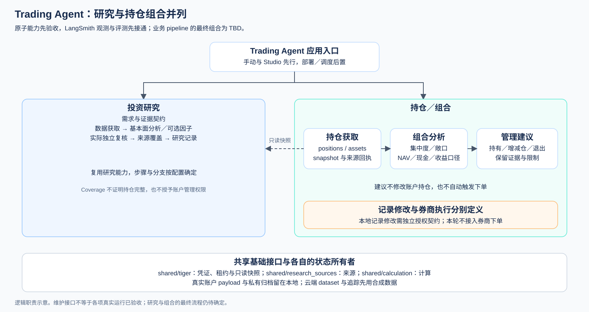
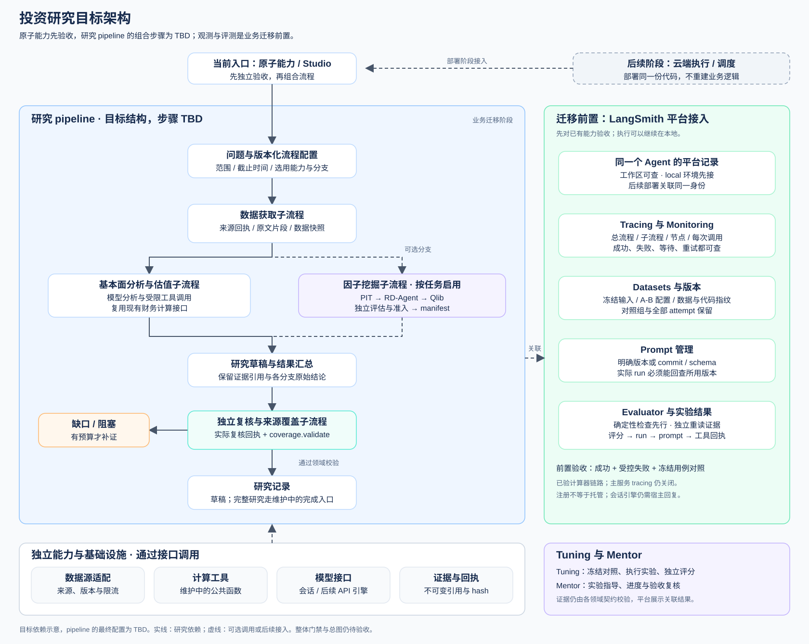
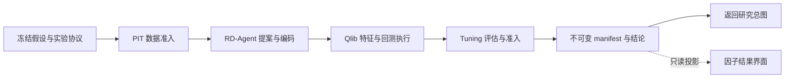
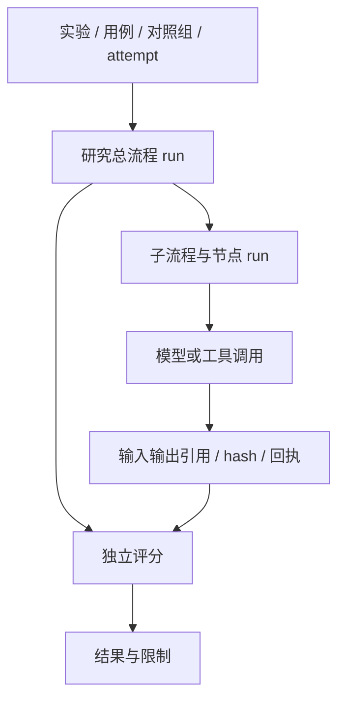

# 投资研究工作流架构与迁移

先把数据获取、计算、来源覆盖、因子结果、持仓获取和组合分析等原子能力分别验收，再组合业务 pipeline。研究 pipeline 的具体步骤仍为 TBD，下面的总图展示目标职责和依赖，不固定最终执行顺序。后续用版本化配置选择能力与组合，便于独立调优和 A/B。

投资研究总流程负责组织一项研究，从确定问题、收集材料，到分析、复核和输出研究记录。数据获取、来源覆盖和因子挖掘作为子流程接入，分别保留自己的输入输出、状态和验收规则。LangGraph 编排这些子流程，需要模型选择工具的节点再使用 LangChain。

这里的「共享投资研究」指各个 Agent 和交互入口复用同一套研究流程。业务编排仍归投资领域，`shared/` 保存通用数据、计算和工具适配，避免把所有研究逻辑都塞进共享工具目录。

## Trading Agent 包含研究和持仓组合

Trading Agent 是应用层总入口，投资研究和持仓／组合是并列的业务职责。研究按需读取持仓快照作为上下文，组合复核可以参考研究结论和 entry policy 证据。它们的最终组合方式仍为 TBD，当前不先实现一个包揽所有账户操作的总 Agent。

`niulai-private` 保留原始私有归档，其中相关持仓代码已在维护路径中找到对应实现。运行时复用 `shared/tiger` 和维护中的适配入口，不从私有归档加载账户状态。源码对照与边界见[持仓能力审查](../architecture/holdings-boundary-review.md)。

| 原子能力 | 复用与适配 | 必须分开的结果 |
| --- | --- | --- |
| 持仓获取 | `shared/tiger` 的 `positions`、`assets`、`snapshot`；保留账户范围、币种、查询时间、价格时间和来源回执 | 只读快照。完整空仓、部分覆盖、读取失败和结果不确定不能混为一谈。 |
| 组合分析 | 薄适配后复用 `niulai/holdings/analytics.py` 等纯函数；显式映射 gateway 与分析函数的输入结构 | 集中度、敞口、NAV／现金、收益口径和缺失信息，不修改账户持仓。 |
| 持仓管理建议 | 组合分析、约束、研究结论和 entry policy 证据 | 持有、增加、减持或退出的建议及限制。建议不等于执行许可。 |
| 本地记录修改 | 若后续需要，另行定义授权、预期版本、请求身份和回读契约 | 本地记录更新，不能把改写快照说成券商持仓已改变。当前没有通用 holdings CRUD 已实现的结论。 |
| 券商执行 | 独立的后续能力 | 这次研究与持仓读取适配不接入下单。 |

持仓与组合 wrapper 归组合业务领域，不能塞进 `investment/research/workflows/`。来源 coverage 检查也不能证明持仓完整或授予账户管理权限。Gateway 读取带凭证租约和 checkpoint 边界，结果为 unknown 时应核对或读取已提交回执，不能因为 Graph resume 就自动重读。

迁移先完成现有 Agent 的平台观测与评测，再开始研究总图的业务迁移。部署、定时调度和业务交付放到后续部署阶段。这份方案描述目标架构，不能据此认定云端平台接入、研究总图或因子真实运行已经实现。

## 现有 Agent 的观测与评测先验收

这一阶段是业务迁移的前置门禁。先保留现有行为，为原子能力接入 LangSmith，建立可对照的基线。计算器 pilot 可以先检验追踪链路，再逐项接入实际使用的能力。尚未定义的研究 pipeline 不作为原子能力验收的前提，也不能用计算器结果宣布整套 Trading Agent 已可观测。

| 能力 | 需要接入什么 | 通过前必须看到的证据 |
| --- | --- | --- |
| 平台身份 | 确认工作区模式，关联现有 Agent 的固定身份与运行环境 | 在工作区找到对应 Agent，并能从一次真实 run 确认关联。若工作区只支持 tracing project，先记录能力差异，不能把它当作 Agent Registry 已验收。 |
| Tracing | 现有入口、子步骤、模型与工具调用的父子关系 | 一次成功和一次受控失败都能在平台查看；输入输出、错误及本地证据回执对应同一次执行。 |
| Monitoring | 运行量、成功与失败、耗时、模型等待和工具调用的统计 | 用上述已知运行核对平台计数和状态。未知的 token 或费用保持缺失，不能填零；会话等待时间单列。 |
| Prompt 管理 | 上传允许共享的 prompt，固定版本或 commit，记录实际使用的版本与内容 hash | 从 run 查到所用版本，能加载指定旧版本复现。实验不能隐式跟随 latest。 |
| Datasets | 冻结一组公开或合成输入、参考结果、用例身份和数据版本 | 平台用例与本地封存用例一致，开发、验证和受保护数据边界明确。不得上传私有原文来凑样本。 |
| Evaluator 与实验 | 先接确定性评分，再按需要接独立复核或模型评分 | 一组冻结用例完成评分，正确结果通过，已知错误被拒绝。从评分能回到 run、prompt、数据与工具回执；缺失或失败用例不被静默排除。 |

验收结果要保留平台链接、实际 run ID、prompt commit、dataset 版本、评分器版本和本地回执。先在相同条件下建立原子能力基线，再比较适配后的实现。接口和最小追踪适配可以先准备，这组平台证据未齐全前，不扩大业务迁移或组合研究总图。

平台认证的只读检查已通过，`trading-agent` 的 EXTERNAL 身份已创建并回读确认。计算器原子能力已验证私有 prompt commit、三条冻结合成用例、真实 LangChain 子步骤 trace、受控失败、监控计数和确定性评分；独立云端回读确认 3/3 feedback、用例与 run 的绑定，以及回读 payload 中没有凭证。

这只通过了计算器前置验证。真实会话模型的原生追踪、持仓能力、托管在线 evaluator 和完整业务门禁仍未验收。现有本地 Agent Server 的云端 tracing 保持关闭，单独的 opt-in CLI 只上传公开合成测试。平台 key 保存在忽略的本地 `0600` 私密文件中，与模型供应商 API key 分开。当前会话引擎仍需宿主逐次回复，不能宣称已具备无人值守批量评测或云端模型调用能力。

## 云端可查与云端执行分开接入

LangChain 是代码框架，LangSmith 提供 Agent 身份、traces、监控、prompt 和评测能力。本地运行可以把允许共享的数据送到 LangSmith，不要求先把执行程序搬到云端。[官方注册说明](https://docs.langchain.com/langsmith/create-an-agent)明确区分平台记录与代码中的 `create_agent`。

目标是在支持 Agent Registry 的工作区中，为现有研究 Agent 注册一次固定身份，先关联 local 环境。子流程先作为同一 Agent 下的子 run，只有确实独立提供服务时才考虑单独注册。后续部署同一份代码时，再关联相应部署环境，保持业务接口和证据身份可追踪。[Agent Registry](https://docs.langchain.com/langsmith/agent-registry)与[部署环境说明](https://docs.langchain.com/langsmith/deploy-to-agent-environment)是接入依据。

注册平台记录不会自动托管执行，也不会把当前会话变成可持续调用的模型服务。当前 `trading_pilot` 的本地 graph/assistant 身份，也不能直接当作 LangSmith Agent Registry 身份。这些关联都要在前置阶段实际核验。

## 总图协调任务，子流程交付结果

[单独打开架构图](diagrams/langchain-research-architecture.svg)。实线表示研究结果的依赖关系，虚线表示可选调用、共享能力或后续接入。图中的因子分支按任务启用，未要求因子的研究不必运行它。

图中的业务路径是供后续配置的示意。现阶段优先落实每项能力的独立入口和验收，完整 pipeline 在这些能力稳定后再确定。

总图决定研究范围、哪些分支必需、哪些分支可选，以及还缺什么。子流程完成一项明确任务，返回带来源和版本的结果。父图据此推进研究，不能替子流程改写准入结论。

| 子流程 | 输入与输出 | 自己负责的边界 |
| --- | --- | --- |
| 数据获取 | 冻结需求、查询与截止时间 → 来源回执、原文片段或数据快照引用 | 调用 `shared/research_sources/` 等公共接口。已有 acquisition controller、driver 和 runner 继续决定预算、派发与重放，Graph 保存它们的引用。 |
| 基本面研究与估值 | 研究问题、有效材料 → 分析草稿、计算结果、经济模型绑定 | 复用 `shared/calculation/`。Alpha discovery 与 entry policy 分开测试，研究结果不直接授权交易。 |
| 因子挖掘 | 假设、PIT 数据契约、实验协议 → 运行 manifest、评估及准入结论 | RD-Agent 提案与编码、Qlib 执行、Tuning 评估、不可变 manifest 和 UI 投影继续分开。公司研究的 coverage 不能替代因子的 PIT、成本、泄漏和准入检查。 |
| 独立复核与来源覆盖 | 草稿、实际引用、模型绑定、独立复核回执 → coverage 回执或缺口清单 | 保留协调方固定的需求 hash，调用 `investment.research.coverage.validate`。完整检查要等草稿和复核材料齐备，不能把刚抓到资料就视为研究覆盖通过。 |
| 研究汇总与完成 | 各必需分支的有效回执 → 研究草稿或完整研究记录 | 草稿阶段只写实验目录。完整研究继续经过 `investment.research.pipeline.finalize` 和 `complete`，保留 Niulai 校验器。 |

必需分支失败或结果不确定，总图就保留缺口，不能标记整项研究完成。可选分支可以明确标为跳过、不可用或 withheld，但报告必须保留这个状态。拿到一个因子 manifest，也不能把它自动当作可用于投资的 alpha。

## 因子挖掘内部继续分工

总图只提交任务和读取有效结果。生成代码的执行隔离、Qlib 环境和实验准入留在因子组件内。后续即使增加因子执行资源，也只替换这个子流程的执行适配，不改变研究总图的业务接口。

当前仓库已有因子请求、回执、manifest 和部分合成验证边界，真实 RD-Agent→Qlib 运行仍未验收。首轮集成只能用明确标识的 fixture 或 withheld 结果验证接口，不能填造实际表现或准入通过记录。

## 按文档思路接入，接口以当前版本为准

参考文档为[《LangChain 与 LangGraph：从入门到实战超详解》](https://bytedance.larkoffice.com/docx/DER6dCHBhokjaVxB1d3cOatMnHb)，本次读取第 181 版的结构化输出、LangGraph 和实践建议章节。下面是对本项目的适配方案。

| 文档中的思路 | 本项目怎样采用 | 接入时需要保留的区别 |
| --- | --- | --- |
| StateGraph 编排节点与条件边 | 用研究总图决定子流程、补证和结束条件 | 主图状态只保留协调信息及结果引用，各子流程管理自己的内部状态。 |
| Subgraphs 复用工作流 | 每个子流程提供独立输入输出，外层 wrapper 显式映射状态 | 默认共享检查点不等于共享所有业务字段。不同子图的 messages、数据和预算不能随意混写。 |
| LangChain 处理模型与工具 | 在研究分析节点中注入 `BaseChatModel`，由 `create_agent` 执行受限工具调用 | 当前 `create_agent` 本身已经基于 Graph，不必把它重新实现成一套手写循环。普通校验函数也不必包装成 Agent。 |
| 结构化输出 | 为模型产物定义 schema，再交给领域校验器检查 | 具体输出策略与修复行为取决于模型和适配器。当前会话引擎不能直接假定支持所有 provider-native 功能。重试必须显式计入预算。 |
| Checkpointer 与 interrupt | 保留本地调试、等待模型回复和受控恢复 | 检查点不替代证据存储、派发日志或业务准入。恢复前仍需服从原模块对 unknown 的处理。 |
| Streaming 与观测 | 记录节点进度、中间产物引用和调用结果 | 可观测性要覆盖外部工具边界，不能只保留模型最后一句回答。 |

以上机制已对照当前安装源码与官方文档。LangGraph 支持[通过 wrapper 映射不同子图的状态](https://docs.langchain.com/oss/python/langgraph/use-subgraphs)，LangChain 的[结构化输出策略](https://docs.langchain.com/oss/python/langchain/structured-output)也有模型能力要求。示例代码只用于理解机制，实施仍使用仓库锁定的依赖版本。

业务 Graph 依赖模型接口，通过装配层注入实现，不直接依赖 tuning 的实验脚本。当前会话模型先作为本地已验证实现。第二个业务调用方落地时，再提取实际复用的适配代码。RD-Agent 内部模型调用需要单独适配和验收，不能假定已经可以换成当前会话引擎。

## 状态通过契约交接

研究总图只需保存研究身份、冻结需求引用、各子流程的执行身份、有效产物引用和未解决问题。来源正文、模型完整上下文和大体积因子数据留在各自组件中，通过 hash 绑定的引用读取。

每次交接至少明确以下内容。字段名是设计说明，具体 schema 在实现前与现有契约逐项对齐，不新增一套竞争的事实来源。

| 交接内容 | 用途 |
| --- | --- |
| 研究、任务与子流程 ID | 知道哪个父任务发起了哪次子流程调用。 |
| 请求版本、输入引用和 hash | 确认实际使用的材料与冻结请求一致。 |
| 截止时间、数据版本、配置和预算引用 | 明确材料可用时间与本次执行条件。因子分支另保留 PIT 和 split 身份。 |
| attempt、结果状态、产物与回执引用 | 区分一次失败、一次新尝试和同一结果的重新读取。保留原组件的状态语义。 |
| 错误类别、限制和未解决缺口 | 让父图知道能否推进、是否需要补证，以及何时必须停下。 |

子图通过 wrapper 返回明确的状态更新。每个父图字段指定一个写入方，多分支结果按子流程与 attempt 归档，避免依靠列表追加混合不同尝试的结果。需要 reducer 的字段先定义合并与去重规则。

建议把总图和研究侧 wrapper 放在拟新增的 `investment/research/workflows/`，因子业务 wrapper 留在 `investment/factor_mining/`。工具仍归 `shared/`，评分仍归 `tuning/`，Mentor 保留指导职责。这是逻辑组织建议，当前不搬动源码，不复制 Niulai 快照，也不改现有因子冻结契约。

## 追踪要能回到每次实验和证据

这是一组关联关系。实验身份、研究身份、LangGraph thread/run 和现有工具回执 ID 各自保留，通过映射关联，不能用一个新 ID 覆盖原来的调用身份。

每次实验固定候选代码、Graph 配置、prompt、工具 schema、数据快照和评分器版本。模型记录请求的引擎与设置，并区分实际观测到的信息。Session ID 和声明的模型名不能充当认证或底层模型身份的证明。

每个节点记录开始结束、状态、父子调用关系、输入输出引用和错误。每次模型调用与工具调用分别记录耗时和次数，缺失的 token 或费用数据填 `null`。等待会话回复的时间单列，不能当作无人值守模型的响应延迟。补证、拒绝、超时、重试与 unknown 也要进入记录。

持仓能力先用重新构造的合成用例验收云端追踪与评分，不导入历史私有 fixture。真实持仓、资产、稳定账户标识和私有路径留在本地。真实账户获取的独立验收仍需保留原有授权、范围和凭证状态约束。

LangChain 调用显式传播 `RunnableConfig` 的 callbacks、tags 和 metadata，wrapper 内的普通函数或外部执行器也要记录相应调用边界。正式依赖这条链路前，用一次成功和一次失败验证父子关系与回执绑定，不能假定写成 Graph 节点就已经追踪完整。[官方追踪说明](https://docs.langchain.com/langsmith/trace-with-langchain)是接入依据。

本地事件和不可变证据引用继续作为原始记录，Studio 用于检查流程。前置阶段就要接通 LangSmith，导出允许共享的视图与关联 ID，不上传凭证或未经批准的原文。平台 key 和权限缺失会阻塞这项接入验收，但不影响本地诊断与恢复。平台显示与本地原始证据需要相互核对。

Prompt 按[官方 SDK 方式管理](https://docs.langchain.com/langsmith/manage-prompts-programmatically)，将 prompt commit 与实际执行配置绑定。Datasets 和[评测目标函数](https://docs.langchain.com/langsmith/evaluate-llm-application)关联现有执行入口，再用同一组用例对照迁移版本。先复用确定性校验和独立证据评分，不把通用模型评分替换成领域准入规则。

Tuning 沿用 `tuning/evals/evidence_runtime/contracts.py` 封存对照条件。评分器重读实际产物和回执，不接受模型自报完成，也不只读取 Graph 的 `passed` 字段。专用 acquisition EIY checker 的匹配规则继续保留，任意 prompt、模型或工具变化不能借迁移之名放宽检查。

## 各子流程可以独立扩展

先在同一项目内按公共接口调用。子图划分支持独立开发、测试和替换，是否拆进程、加队列或部署成服务，等到实际资源瓶颈出现后再决定。

| 子流程 | 可以独立调整的资源与策略 | 必须保持的接口和约束 |
| --- | --- | --- |
| 数据获取 | provider 并发、限流和缓存复用 | 来源身份、日期、回执，以及原有派发与 unknown 边界。 |
| 研究分析 | 模型引擎、上下文策略和调用预算 | 冻结输入、工具权限和结构化结果。 |
| 来源覆盖 | 校验批次、独立执行和回归用例 | 需求 hash、实际片段、模型绑定和独立复核要求。 |
| 因子挖掘 | 独立执行资源和数据分片 | 环境隔离、PIT 数据、实验协议、评估准入和 manifest。 |
| Tuning | 用例批次、对照试验和独立评分执行 | 候选指纹、相同预算、全部尝试记录，以及受保护数据边界。 |

父图对子流程只保留完成条件、预算上限和结果引用。独立扩展不承诺默认并行，也不意味着每项研究都调用所有分支。先确认数据与任务没有冲突，再增加并发。

## Pipeline 保留配置与 A/B 入口

原子能力先各自提供稳定入口、输入输出 schema、配置版本、错误和证据回执。数据获取或 coverage 可以保持普通函数；需要多个步骤或模型决策时，再在相同接口后组合为子图。能力先能独立运行和评分，后续才能判断整条 pipeline 的变化来自哪里。

Pipeline 的最终步骤和组合方式为 TBD。先用少量受控代码定义组合结构，用配置选择已注册的能力、模型引擎、prompt commit、参数和预算。等实际需要改变的分支明确后，再决定哪些边也应配置化，避免提前实现任意工作流语言。

每个候选保存 pipeline 配置及其 hash，连同能力版本和输入数据形成可复现的执行条件。配置只允许选择公开接口和已登记实现，不从配置执行任意 import 或 shell。冻结的证据要求和领域准入规则继续由各模块管理，不能作为 worker 可随意调整的实验参数。

A/B 分两个范围执行。先比较单项能力，再比较完整 pipeline。每次声明 baseline、candidate 和本次改变的因素，固定同一批输入、数据版本、截止时间、预算和评分器。其他因素保持一致。每个 run 都关联 `case_id`、`arm_id`、`attempt_id` 与配置指纹，失败和 unknown 也保留在对照结果中。

## 先验子流程，再验整项研究

| 验收层次 | 最小检查 | 通过后允许说明什么 |
| --- | --- | --- |
| 单个子流程 | 一个有效输入，以及一个缺字段、缺证据或执行失败的负例 | 该子流程的输入输出和失败方式明确。 |
| 父子交接 | 同一份冻结输入直接调用原函数，再通过 wrapper 调用 | 结果和证据引用一致，Graph 没有改写业务规则。 |
| 分支集成 | 必需分支失败、可选分支 withheld、恢复后重新读取回执 | 总图正确保留缺口和完成条件，没有把局部成功当作整体成功。 |
| 调优追踪 | 从一项评分反查用例、候选、父子 run 和实际证据 | 对照可归因，失败和尝试没有遗漏。 |
| 本地研究 E2E | 冻结公开材料 → 分析草稿 → 实际独立复核 → 来源覆盖 | 这条研究草稿流程已经接通。研究质量或投资 alpha 仍需单独评估。 |

原子能力阶段先逐项验证有效输入，以及缺必需片段、文件 hash 被修改等相应负例。能力与平台门禁通过后，再按选定配置接通一条研究草稿流程。因子子流程先接已标明 provenance 的合成结果或 withheld 回执，验证父图能否正确处理，不等待真实因子引擎部署完成后才开始其他研究能力的集成。

每个确定性用例先运行一次。沿用首轮每用例至多三轮模型调用的预算，两组固定同样的 prompt、工具 schema、模型设置和单次调用边界。记录试过的全部版本。涉及随机质量、alpha 或 entry policy 的对照，再单独确定样本、重复次数和划分，比较时固定其他因素。数据包排除答案，也不等于同一用户文件系统已经实现盲测隔离。

首条路径只写实验草稿，不调用券商、邮件或生产发布。补证必须有剩余预算，并保留冻结要求。不能无限循环到模型表示满意，不能用降低要求代替补齐证据。

## 先原子能力，后研究 pipeline

1. 明确原子能力的接口、状态和独立验收用例，沿用现有公共函数，准备最小追踪适配。
2. 从计算器等已有路径开始，实测平台身份、tracing、monitoring、prompt、datasets 和 evaluator，再逐项为实际业务能力保留可对照基线。平台门禁未通过，不扩大业务迁移。
3. 逐项完成能力适配与单项 A/B，检查原函数和 wrapper 的结果、证据及失败方式是否一致。因子结果接口先验证 provenance 与 withheld，不虚构真实运行。
4. 能力稳定后，再确定仍为 TBD 的研究 pipeline，用版本化配置组装，传播既有追踪关联。
5. 在相同用例和评分条件下运行 pipeline A/B，检查整体完成条件、分支失败与证据链。部署与调度继续后置。

现有计算器 pilot 继续保留为模型和工具边界的回归路径。2026-11-15，提交 `989149d` 的本地服务已重启，新 E2E 得到每股 `"15"`、工具执行一次，独立重读校验通过，8 个历史线程及结果保留，42 项无需外部模型服务的检查通过。这些证据只覆盖计算器 pilot，不能用于宣称研究总图已经接通。

## 调度与部署留到后续阶段

总图接通后，先通过手动或 Studio 入口调用同一研究总图。后续部署 Agent 时，再接调度器、资源分配、业务交付和相应生产运行时。它们调用已经验收的研究入口，不反过来定义研究子流程。

部署阶段继续遵守 [runtime acceptance 契约](../deployment/runtime-acceptance.md)，包括禁用候选、备份与回滚，以及真实未来调度业务运行和验收邮件回读。该验收适用于后续生产激活，不阻塞当前本地研究架构、子流程接口和调优追踪的开发。已有生产调度和交付路径保持原状。

现有源码依据见 [投资研究接口](../../investment/research/README.md)和[数据源接口](../../shared/research_sources/README.md)。因子参考路径为 `factor/README.md` 与 `docs/plans/factor-mining-integration.md`，它们目前只在工作区，本次提交不包含。早期审查见 [数据与计算](../../tuning/langchain_pilot/reviews/acquisition.md)、[运行时](../../tuning/langchain_pilot/reviews/runtime.md)、[技能与评估](../../tuning/langchain_pilot/reviews/skills-evaluation.md)。环境说明见[本地 pilot 部署说明](../deployment/langchain-pilot.md)。

对参考文档的理解、适用边界和可复用结论另存于[LangChain 架构参考笔记](../architecture/langchain-design-notes.md)，后续设计可先查笔记，再核对锁定版本的源码与官方接口。
