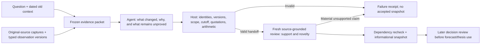

# NOW: runtime contribution handoff and measured limits

2026-10-31. A small investment-owned component now sends the actual agent a
contribution task, checks its structured handoff in application code, obtains a
separate source-grounded review and saves a dependency-checked informational
snapshot. This uses the existing execution runner, configured model adapter,
hashed artifacts and Store; it adds no service, database, credential owner or
active MCP/action registration. It does not automatically update a forecast,
investment thesis, valuation or trade.

## What the agent actually receives

`investment/research/contribution_run.py:run_case` constructs one agent phase.
Its inputs are the question, dated old hypotheses, hash-bound baseline, source
excerpts and observation IDs/versions/scope. Its objective is the literal
`CANDIDATE_OBJECTIVE` in `investment/research/contribution.py`, including:

* Keep facts, incremental contribution, economic inference, unproved links and
  proposed changes distinct.
* Compare meanings against old hypotheses; a new name need not be a new mechanism.
* A counting unit does not establish price, extra purchases, revenue or profit.
* A pending driver does not authorize a numerical forecast change.

The actual model must return the closed `PROPOSAL_SCHEMA`. The existing phase
runner validates that response and invokes `candidate_finalizer`. An exception
blocks the mechanical handoff. The separate reviewer compares source meaning
and old context; `checkpoint_review` binds the real author/reviewer sessions and
exact outputs, then uses the existing snapshot CAS to recheck current dependencies.

The semantic workflow is exercised by the isolated evaluation/acceptance driver.
It is not installed into every normal research execution. A caller must use both
the mechanical and semantic boundaries; a mechanical `completed` status alone
means neither financial truth nor decision approval. Existing full-company
finalization remains separate.

## The NOW example

The [AI Control Tower subscription-unit document](https://www.servicenow.com/content/dam/servicenow-assets/public/en-us/doc-type/legal/ai-control-tower-servicenow-subscription-unit-overview.pdf)
defines one managed AI Asset record as one Subscription Unit. It does not supply
a realized net tariff, paid asset conversion or incremental recognized revenue.
Its effective date is not a verified publication date, so it was excluded from
the historical May-cutoff facts and used only in current-cutoff questions.

The actual candidate answer classified this as a **refinement** of the supplied
governance-commercialization hypothesis. It explicitly preserved earlier non-seat
pricing as old, unverified context; the captured older filing excerpt lacked the
relevant pricing passage. It did not claim a company-first revenue mechanism.

Its economic chain was: counted assets could grow independently of seats;
additional revenue would require units beyond existing entitlements, actual paid
commitments and positive incremental net prices. Missing links included adoption,
allowances, discounts, bundling, displaced purchases, contract/recognition timing
and delivery costs. Its proposed action was to qualify the hypothesis, without
changing financial assumptions. The generic baseline reached a similarly careful
conclusion on this question.

The [May 6 launch release](https://newsroom.servicenow.com/press-releases/details/2025/ServiceNow-Launches-AI-Control-Tower-a-Centralized-Command-Center-to-Govern-Manage-Secure-and-Realize-Value-From-Any-AI-Agent-Model-and-Workflow/default.aspx)
supports different availability states for Control Tower and Agent Fabric.
Candidate A made the missing commercial steps—billing units, net price, bundles,
substitution and recognition—more explicit than B. Both independent review orders
preferred A on this case. Availability still did not establish monetization.

## What scripts enforce

`validate_proposal` resolves the actual baseline artifact and Store heads. It
checks evidence membership, observation/lifecycle revision, source hash and
access, entity, period, currency, unit, basis, availability cutoff and later
source modifications. Quotations allow whitespace-only variation and produce
the exact archived text span; changed words or numbers are rejected. The agent
does not calculate its own trusted citation offsets.

Given an explicit forecast assumption, Decimal arithmetic checks the change
against the same target/scope and requires changes to be labeled assumptions.
`calculate_scenario` reuses the existing PV operator: 1,000 assumed paid units ×
$120 annual net price gives $120,000 revenue; 25% margin gives $30,000 operating
profit; 80% cash conversion gives $24,000 FCFF; one year discounted at 20% gives
$20,000 PV. These are synthetic conditional inputs, not observed NOW economics
or a company valuation. No terminal value is included.

Mechanical checks do not certify semantic support, whether old research already
contains the mechanism, or whether an assumption is reasonable. Those judgments
remain with the source-grounded and later decision agents.

## Frozen A/B and results

Eight source-bound atomic questions used the same sources, controlled old
hypotheses, model/effort, closed schema and limits. A added the explicit contribution
objective and typed host gate; B used competent generic structured research in
the same runner. This compares the combined intervention, not isolated prompt
versus validator effects or the older full-company admission gate. Retrieval was
fixed before both arms, so this is not a source-router quality comparison.

Each answer received two fresh anonymous model reviews in opposite orders.
No later outcomes or arm/process labels were in the review packets. Same-family
AI review, no human calibration, no OS isolation, familiar NOW material and
correlated questions limit the result.

| Measure | A: contribution workflow | B: generic structured research |
|---|---:|---:|
| Source-supported facts, both review orders | 21/21 | 24/24 |
| Unsupported economic inferences | 0 | 0 |
| False novelty claims | 0 | 0 |
| Unsupported numerical revisions | 0 | 0 |
| Natural handoff metadata errors under the repaired typed check | 0/8 | 1/8 |
| Specific missing-link score, ordinal mean out of 2 | 2.000 | 1.875 |
| Counterevidence score, ordinal mean out of 2 | 1.875 | 1.875 |
| Author turns | 8 | 8 |
| Author wall seconds | 261.93 | 262.00 |
| Reported input + output tokens | 259,848 | 259,264 |

These ordinal differences are descriptive, not probabilities or significance.
There was one consistent A preference, five consistent ties and two order-dependent
preferences. One reviewer penalized A for omitting the federal-budget caution;
another comparison exposed omission of geopolitical caution. The stronger prompt
did not uniformly improve counterevidence. Both arms were already careful, so
the predeclared fewer-unsupported-claims superiority condition was not established.

The real B handoff error tagged an Assist-usage observation as an entitlement-tier
unit. The strict validator rejected the mismatch although the source reviewer
supported the narrative. This illustrates why semantic review and typed identity
checks are separate. It is not a measured false financial claim.

Sixteen injected invalid handoffs all passed JSON-shape validation and all were
rejected by the typed boundary. This demonstrates fault coverage, not a natural
error rate or proof that an older domain gate would accept them. Missing/future
availability, modified historical sources, corrupted bytes and arithmetic domain
errors also have direct component regressions.

## Forecast result and source limits

The [April release](https://newsroom.servicenow.com/press-releases/details/2025/ServiceNow-Reports-First-Quarter-2025-Financial-Results/default.aspx)
provided Q2 subscription-revenue guidance of $3,030–$3,035 million. Both arms kept
the controlled $3,032.5 million midpoint. The [July release](https://newsroom.servicenow.com/press-releases/details/2025/ServiceNow-Reports-Second-Quarter-2025-Financial-Results/default.aspx)
later reported $3,113 million: both have signed error **−$80.5 million** and
absolute error **$80.5 million**. Two questions share this one target and must not
be counted as independent forecasts. Q3 actual was not retrieved in the bounded
source attempts; it remains missing.

There is **no measured improvement in forecast accuracy or forecasting bias**.
Avoiding an unsupported optimistic revision can be good research discipline
without reducing realized error. The controlled baselines are not historical
fund forecasts. Currently retrieved issuer-dated documents are reconstructed
history, not verified original-publication bytes; the modern model may know later
outcomes. The edited FAQ and unknown-publication legal document were not silently
backdated. Raw captures are search-tool text representations, not original
HTML/PDF byte archives. Native delegated source access worked; parent native
transport and bounded direct HTTPS failures remain recorded, not reclassified as
success. No current live-provider reliability gain is established by this A/B.

## Verification, failures and effort

The original v1 run was stopped for a source-ID/claim-ID conflation defect; all
attempts and unfinished cases remain recorded. Version 1.0.1 generated all 16
answers and 16 actual review calls. It exposed two additional false blocks:
table whitespace in quotations, and the grader comparing copied-artifact paths
instead of hash-verified content identity. The original grading ledgers remain
failed.

Guard version 1.0.2 repairs whitespace-only quote handling and content binding.
No answer was regenerated to improve the comparison. A newly sealed captured-only
regrade passes both full rosters; a separate 17-case conformance round covers all
16 frozen answers plus the complete fault matrix. It admits all eight valid A
handoffs and still rejects B's unit mismatch. Exact quotes remain source-located;
changed words/numbers and corrupt anonymous copies are rejected. Original source
bytes for the failed grading version are retained privately.

The investment suite passes **87 tests**, plus **one grader regression**. Focused
tests are subsets, not extra independent cases. The 16 two-order review calls
reported **1,616,424 input + output tokens**, versus 519,112 for the 16 author
calls. Actual charges are unknown. Review dominates this evaluation cost; this
does not justify running two-order pairwise reviews on every imported record.
Spend reasoning on changed questions, use captured regressions for routine code
repairs, and reserve fresh model/provider runs for changed behavior or material
uncertainty. Semantic/review-result caching is still deferred.

Fresh future-triggered change `now-handoff-20261031-v102` passed the margin case
on its one scheduled attempt: 0.92 seconds start lateness and 84.51 seconds
execution, with new author and reviewer sessions. Independent readback verified
all four exact source spans, four supported facts, zero critical/unsupported
inference/false-novelty/unsupported-revision findings, current snapshot dependencies,
rejected invalid-reference input and exact arithmetic. Its temporary launchd label
is absent. The configured-owner email status is recorded in the deployment runbook
and private change record. This uses captured sources, not a fresh provider fetch;
it is not production activation, full-company admission or forecast validation.

The useful current gain is a reproducible, failure-visible handoff that catches
identity/scope errors and keeps hypotheses separate from facts. General semantic
superiority and reduced prediction bias remain unproved. The next appropriate
quality test needs different companies/events, genuinely revision-worthy evidence,
balanced favorable/adverse cases and later resolved targets—not repeated NOW
runs until the candidate wins.
