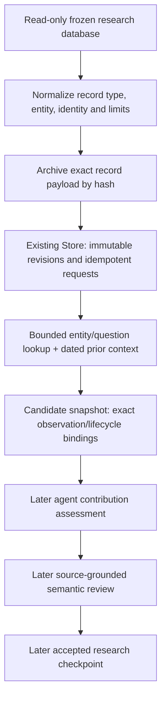

# Raw records to indexed research snapshots

The supplied `information_value_validation_20261031.zip` is an offline prototype.
Its verification was inspected and rerun in a private workspace-local copy.
The implemented extension here is an isolated catalog/notes ingestion component;
it is not an activated scheduled pipeline or a validated information-value judge.

Follow-on work is recorded in [the NOW contribution report](now-contribution-e2e.md):
an actual agent/host/reviewer/informational-snapshot path now has isolated scheduled
acceptance and verified owner notification. The scope below records the original
catalog component. Neither extension activates the full production pipeline, and
the NOW comparison did not establish general semantic or forecast superiority.

Only the path through the candidate snapshot is implemented and exercised here.
It saves discoverable information without certifying claims or accepting thesis
revisions. Forecast, valuation, market anticipation and trading tests remain
separate. Runtime activation would need the existing future-scheduled Codex and
verified owner-email acceptance, beyond these foreground component checks.

## Reuse and implementation

- `shared/research_sources/indexing.py`: closed record contract, immutable raw
  archival, CAS revision updates, hash-checked reuse, bounded entity/term lookup,
  explicit unknown dates, deferral and candidate snapshot publication.
- `investment/research/catalog.py`: a read-only adapter for the existing Niulai
  database schema. It imports artifact/section metadata and the latest active
  evidence/assessment notes. It never replays jobs or follows stored file paths.
- Existing `artifacts.py` and `Store` supply durable hash-addressed files,
  idempotent requests, observation histories and atomic dependency checks.
- `tuning/evals/catalog_index/` supplies the bounded workload and host-side
  independent state checks, using existing sealed contracts and attempt ledgers.

No new database engine, service, scheduler, embedding system or runtime dependency
was added. Each output is bound to one frozen record roster. Identical reimports
reuse it; a changed or deleted roster requires a fresh output directory. This
prevents silently retaining removed records as a current imported corpus. Full
incremental catalog synchronization/tombstone reconciliation is deferred.

The adapter's input types remain `catalog_metadata`, `section_metadata`,
`evidence_note` and `assessment_note`. A catalog may assert that a report was
previously read, yet its bytes may be absent locally. That assertion stays in the
raw metadata and does not become `document` access. A note with an issuer URL is
still a secondary note. Original availability is unknown unless actually
established; import/retrieval time does not become historical publication time.

Multi-asset reports retain entity associations while sharing the same underlying
raw/source identity. Unknown upstream note lineage is grouped conservatively;
it is not counted as independent confirmation. Relevance keyword matching is
only a discovery filter. It does not score semantic support, novelty or value.

The legacy security registry and relation tables are not perfectly aligned.
Unregistered labels and the unmapped bucket are exposed for reconciliation;
the adapter does not guess aliases or silently discard them. Protected scopes
are excluded by the adapter policy; no protected report body was fetched.

## Verification interpretation

The prototype's frozen replay, functional tests and evaluator fault tests were
rerun. Rebuilding its normalized data from the included XLS/XLSX sources exactly
reproduced the frozen feature and label files, the 15 published rounded statistics
and 256 same-provider horizon checks. The required spreadsheet readers were
installed only in a task-local target directory, outside runtime environments.

All 36 package-manifest entries matched. One original execution-receipt hash for
`source_integration_review.json` differs from the final packaged file. Preserve
that provenance qualification; the final package manifest itself matches. The
replayed forecast metrics do not establish company forecasting, semantic agent
quality, current connectivity, strict historical vintages or investment alpha.

The new component's source-derived normalization/index test freezes a complete
corpus roster before execution. Host checks read stored payloads, raw hashes,
entity results, snapshots and original database bytes rather than accepting a
worker's pass labels. The first run found an observability defect: concurrent
replayed requests were sometimes labeled `created` despite correct storage
deduplication. That run is retained. Version 1.0.1 distinguishes actual writes
from request replays and adds a stricter route-count assertion.

The ten conformance cases cover complete associations, exact raw readback,
per-entity retrieval/snapshots, metadata/secondary access distinctions,
idempotency, 20,000 actual durable-index replays, four-process overlapping writes,
stale snapshot rejection, future/unknown availability and source immutability.
Unit checks additionally cover malformed/oversized data, corrupted bytes,
withdrawals, source sharing and changed-roster rejection.

Twenty thousand replays are not twenty thousand unique full reports. The original
prototype's CPU-only metadata timing excludes database/file I/O; it is not
comparable to the new durable-index timing. Report both definitions honestly.
Indexing correctness and catalog hit coverage are distinct from original report
availability and semantic information value. Private receipts retain actual
counts, timings, memory, every attempted version and the unchanged source hash.

## Next narrow integration

Expose the candidate query/snapshot operation through the existing pinned action
registry only after its actual host integration is tested. An existing agent can
then consume a small changed-question bundle: candidate snapshot, prior knowledge,
question and budget. It proposes supported observations and contribution links;
the independent review checks exact source meaning before accepted research use.

Use extraction keys `payload + extractor version`; contribution keys `question +
baseline + evidence bundle + policy`; review keys `claim + dependencies + review
policy`. Hashes and snapshots make these keys reproducible, but the latter two
semantic caches are not implemented by this catalog adapter. New complementary
evidence can reopen a question; hypotheses retain their type. Spend reasoning
per changed question, rather than adding a model call to every imported record.

First test a small source-bound contribution round with matched model, evidence
and budget. Retrieval changes, actual report-body recovery, information-value
judging and later forecast-history validation need their own evidence. Missing
report bodies are an acquisition dependency, not a successful document read or a
reason to invent publication dates. Do not bulk-fetch private pointers or enable
active MCP servers as a side effect of normalization.
