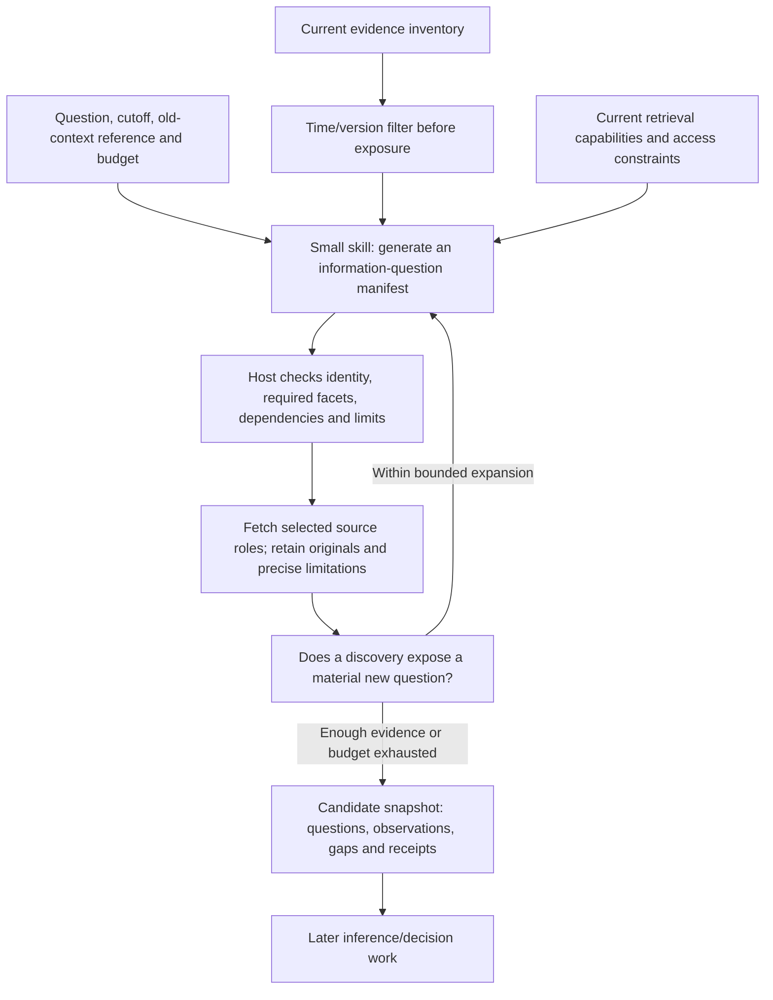

# Runtime information catalog and data-richness evaluation

2026-11-01. The next decision is whether the data layer supplies a broader,
deeper, timely and consistently usable candidate evidence set. Forecast error,
priced-in estimates, valuation and returns are outside this round. A useful
document can improve the candidate set without justifying a forecast revision.

## What exists and what is missing

The read-only current database audit finds 74 registered securities, 81 entity
labels and 713 report/note associations, including 17 for NOW. Six unregistered
ticker labels and an unmapped bucket remain visible for reconciliation. These
are associated catalog/section/secondary-note records, not independent original
documents. All 713 retain unknown original availability times.

`investment/research/catalog.py` imports that inventory. `RecordIndex.select`
performs entity/term discovery and candidate snapshots; it returns unknown-date
records with a warning. That behavior is useful for current discovery but cannot
alone isolate a historical agent. The new historical preflight kept every such
record out of all 81 worker contexts, including titles and note contents. Empty
historical context is an honest gap; it must not be replaced by today's notes.

`shared/research_sources/catalog.json` describes five provider/capability entries.
`routing.py` matches frozen requirements to those declarations. Readiness remains
unchecked until actual execution. The current generic document adapter's host
allowlist does not cover NOW newsroom/community/legal hosts; native/Work search
is an authorized manual workflow, not a registered CLI model tool. Current
requirements profiles also do not dynamically decompose a company's question.

## Combine three different objects

| Object | What it means | How it changes |
| --- | --- | --- |
| Evidence inventory | What records/versions we possess and can actually access | Acquisition, indexing and revisions |
| Capability registry | What supported tools can discover/read, with constraints and observed readiness | Reviewed adapter/config changes |
| Runtime information manifest | What this question needs, gaps, candidate source roles and stopping rules | Agent proposal plus application checks; bounded additions after reading |

Read the first two at runtime and pin their versions. Do not teach the agent an
ever-growing per-stock URL list. Keep a few stable source-role defaults—filings,
issuer specifications, legal terms, customer operations, independent tests and
contrary perspectives—and let the current question select among them. A discovered
site is a candidate, not permission to activate a connector or bypass host policy.

The implemented candidate is deliberately small: `information_catalog.py` builds
separate worker-context and host-diagnostic artifacts, reads the existing registry,
loads the project-local skill and compiles a closed question manifest. Questions
have an ID, facet, reason, evidence need, source roles, capability IDs, dependencies,
priority and stop rule. Budgets are host supplied. Required facets cannot disappear
or become optional. Amendments preserve parent questions, add new questions under
the same context and stop at the expansion ceiling. Artifacts are immutable; this
prototype writes no mutable plan head. Integrating concurrent plan selection can
reuse the existing Store CAS, rather than adding a second database or queue.

This is a candidate contract, not an activated agent-fetching loop. The compiler
does not authenticate document vintages, judge semantic completeness, reserve
global call budgets or dispatch tools. Those checks belong at the later executor
boundaries. Skill discovery is not claimed: the context builder explicitly loads
the project-local skill body and pins it.

## NOW: breadth plus directed depth

Start from a neutral question about changes in the company's operating and
commercial mechanisms. After an eligible source identifies a product or mechanism,
add focused questions. A historical pre-launch prompt must not contain a product
name learned from later documents.

| Information branch | A useful question to resolve | Useful source roles |
| --- | --- | --- |
| Business mechanism | What is purchased or counted; is this new to the old baseline? | Dated issuer statements, contractual definitions, pricing/entitlement terms |
| Architecture | What do Control Tower, Orchestrator and Fabric each do? | Versioned technical docs, release notes, architecture examples |
| Multi-agent execution | How are agents discovered, invoked and authenticated; which protocol/version? | Engineering documentation and executable integration examples |
| Operational limits | What happens under concurrency, missing callbacks, failed tools or policy changes? | Troubleshooting, compatibility tables, actual tests and issue reports |
| Customer economics | Which workflow, baseline, population, period and costs produce the claimed benefit? | Named customer evidence, customer-side operations, measured studies |
| Adoption | Announcement, pilot, production deployment, paid commitment or renewal? | Defined operating disclosures, customer confirmation, contracts where available |
| NOW economics | Counted units → purchased units → net spend → recognized revenue; which links remain absent? | Entitlements, commercial disclosures, accounting scope |
| Rival evidence | Bundling, weak utilization, implementation expense, substitutes or limited compatibility? | Customer/competitor evidence, independent tests, contrary disclosures |

Today's bounded public research used the authorized ChatGPT Work fallback; parent
native transport was not retested. The browser showed completed web-search/source
activity and an eight-source map. The supervising agent separately opened the
engineering article, the January release, the customer story and the legal PDF.
Provider-item counts and tokens for the Work route are unknown.

Concrete source-grounded examples:

* The [January 29, 2025 earnings release](https://newsroom.servicenow.com/press-releases/details/2025/ServiceNow-Reports-Fourth-Quarter-and-Full-Year-2024-Financial-Results-01-29-2025-traffic/default.aspx)
  explicitly describes intended consumption monetization and including AI Agents
  in existing premium SKUs while foregoing incremental upfront subscriptions.
  This is an early disclosed commercial intention, not a verified revenue inflection.
* The [April 20, 2026 employee engineering article](https://www.servicenow.com/community/ceg-ai-coe-articles/servicenow-as-a-primary-a2a-agent-discovering-and-invoking/ta-p/3528579)
  describes Agent Card discovery, credential-bound invocation and a sandbox
  demonstration. Its Zurich-version limitations include missing parallel tasking
  and a callback configuration that can silently cancel invocation. This is
  substantially deeper candidate evidence than an interoperability slogan, but
  not our inspection or replication of proprietary production code.
* The [Accenture customer story](https://www.servicenow.com/in/customers/accenture-ai.html)
  reports 899 governed AI assets and operational improvements. It lacks clear
  measurement periods, cohort denominators and implementation/ongoing costs.
  Publisher is the supplier, perspective is the named customer; it is not an
  independent ROI study. Publication date is unknown, so current text cannot be
  assigned to an earlier historical cutoff.
* The [live subscription-unit PDF](https://www.servicenow.com/content/dam/servicenow-assets/public/en-us/doc-type/legal/ai-control-tower-servicenow-subscription-unit-overview.pdf)
  visibly says effective April 9, 2026. Search exposed an older date at that same
  URL. Effective date, publication date, actual body version and first observation
  must remain distinct. An old search representation does not authenticate an
  earlier legal version. The earlier captured research remains preserved with its
  original qualifications; it is not silently replaced.

These are source-map development examples, not sealed historical recall results.
The remaining map entries are candidates for technical governance, evaluation use
and current operating disclosures; their quantities are not promoted here without
separate source/version checks.

## Multi-dimensional labels

Keep document labels separate from claim labels. Use multiple topic labels, not
one mutually exclusive bucket. A technical document can change a business-mechanism
question; an analyst report can contain reported facts, estimates and opinions.

| Axis | Example values | Boundary |
| --- | --- | --- |
| Publisher relationship | Issuer, customer, competitor, regulator, academic, sell-side, journalist, aggregator, unknown | Identifies who publishes; no universal trust ranking |
| Document form | Filing, earnings release/transcript, technical doc/paper, benchmark, legal terms, customer case, analyst report, news, discussion | Describes format, not whether a claim is true |
| Topics, multi-label | `business.model`, `financial.performance`, `financial.position`, `technical.architecture`, `technical.limits`, `unit_economics`, `adoption`, `competition`, `risk` | Extend a versioned namespace; no ticker-specific schema migration |
| Economic perspective | Supplier, customer, competitor, market, regulator, researcher | A supplier-hosted customer story can carry customer perspective without becoming independent customer publication |
| Claim knowledge status | Reported actual, measured result, contractual definition, management target, forecast, analyst estimate, opinion, inference, hypothesis, unknown | Subjectivity is attached to the claim; document summaries may be mixed |
| Time and version, inherited | Event/target period, publication, version availability, modification, first observation and ingestion | Read from the bound source/observation; never reset on a cache hit |
| Lineage and scope, inherited | Original upstream family, copied/derived material, metric definition, entity/period/unit and access level | Two republishers do not become two independent observations |
| Annotation provenance | Rule/model/human, policy version, provisional/reviewed, exact review reference and limitations | A classification or review flag is not truth certification |

The candidate `information-labels.schema.json` implements the small new annotation
fields and binds them to source/claim references. Existing source/observation
metadata supplies time, lineage and numeric scope; do not duplicate those fields
and allow them to drift. Store labels as versioned sidecar artifacts, preserving
raw bytes and older assignments. Relabel by source version + claim version +
label-policy version. No universal `quality_score` or `verified=true` is added.

`information-taxonomy.json` supplies a small canonical topic vocabulary separately
from the schema, so adding a reviewed topic does not require changing the record
shape. Preserve unfamiliar proposed tags as provisional and reconcile overlap
before publishing stable IDs. Keep unknown/unclassified information discoverable;
an early classification error must not permanently hide an important new mechanism.

For example, a sell-side report remains `publisher_kind=sell_side`; a row copied
from a filing can be `reported_actual` with issuer lineage, while its forecast is
`analyst_estimate`. Conversely, an issuer's forecast remains a forecast. Semantic
topics and epistemic labels start provisional when inferred; endpoint rules can
fill obvious publisher/form fields cheaply. Review consequential ambiguous labels,
not every imported row with a second model call. Reviewed-reference presence is
only structural; authentic review/source support still needs the existing gate.

## Next A/B: information-richness metrics

The detailed design is in `tuning/evals/information_fetch/protocol.json`. Its
reference standard is a bounded, source-grounded information roster, not later
stock winners or final forecasts. Mentor-side hindsight searches may identify
what was discoverable; the worker sees only eligible historical versions.

Report separately:

* Supported reference-item coverage, deduplicated by underlying information and
  grouped by ticker/event. Call it bounded reference coverage, not universal recall.
* Breadth across relevant mechanisms, economics, adoption, financial condition,
  technical constraints and contrary evidence. Irrelevant category filling earns
  no credit; not every stock needs papers or a multi-agent architecture branch.
* Depth: specific scoped mechanism; measured constraints; quantified customer
  economics with denominators/costs; production versus paid adoption. Preserve
  partial/unknown fields instead of rewarding paragraph length.
* Incremental candidate contribution versus old context, including useful
  confirmation, corrections, contradictions and complementary evidence. Count
  unique supported information, not URL count or phrasing changes.
* Freshness and continuity: earliest verified source-version availability to first
  captured replay checkpoint, updates retained across successive snapshots,
  missed revisions and unresolved conflicts. A coarse replay gives an interval,
  not an actual historical 24-hour ingestion SLA. Prospective runs measure real lag.
* False acceptance, time leakage, wrong metric/definition, lineage inflation,
  false blocking, query/fetch success, cache integrity, retries/fallbacks, latency
  and measured usage/cost. Missing or unavailable cases stay in the denominator.

A is the actual available add-on workflow, including runtime catalog generation,
static capability defaults, supported cache/recovery and typed ingestion. B is
competent normal search/open with the same cutoff, backend, model and budget.
Time filtering protects **both** arms. Freeze actual feature usage; unavailable
features are gaps, not assumed treatment. Add a static-only ablation later if the
first comparison cannot attribute a meaningful gain.

Historical search cannot merely add `before:` to a live query: titles, snippets,
redirects, page revisions, old context and warm caches can all leak future facts.
A host broker must expose only an approved source-version corpus, and filter
before emitting any search metadata. Current unversioned pages cannot substitute
for old bodies. Disable worker file/network/app tools and capture actual tool
events; oracle packets remain host-only. Source-bound outputs reject unsupported
facts recalled from model memory, but do not erase future knowledge from weights.
An actual filesystem sandbox and broker are not implemented by the context
prototype; do not claim protected blindness or strict historical performance yet.

## Controlled effort and sequence

1. **Full-population preflight, completed:** freeze current roster and registry
   gaps; check all 81 entity labels. All existing unknown-date records are held
   out of historical worker context. This is not an all-ticker fetching A/B.
2. **Reference preparation:** build NOW's 24-month monthly/event timeline, including
   no-change and adverse windows. Separate stable old versions, qualified
   reconstructions and inaccessible history. Recover authentic dates/bodies;
   do not guess that a numeric non-seat revenue inflection happened six months ago.
3. **Small discovery pilot:** at most ten matched case windows, including several
   NOW dates and other preselected database securities across source/readiness
   strata. Freeze cases, source boundary, oracle, actual tools and budgets before
   author outputs. Do not select only well-documented SaaS success stories.
4. **Full database rollout of evaluation:** retain the complete current-stock
   roster and two anchor cutoffs per asset. Execute in bounded batches after the
   pilot's critical guards pass. A batch report identifies completed, missing,
   inaccessible and not-yet-run assets. Sampling does not satisfy all-stock coverage.
5. **Prospective capture:** use the same receipts on newly published material to
   validate actual freshness without retrospective-vintage uncertainty. Production
   activation still needs future-triggered session and exact owner-email acceptance.

Use deterministic conformance/fault/captured-data checks first. Source-grounded
review judges information support and missed material branches; reserve repeated
or order-swapped model review for ambiguous comparisons/calibration. The previous
NOW evaluation's expensive paired reviews should not be repeated for every note.
Stop for critical leakage/false completion, diagnose and version repairs, retain
all cases and attempts, and never rerun until A wins. A broader/deeper supported
candidate set without integrity loss is the intended improvement; predictive
superiority is neither required nor claimed.

Current verification: seven focused catalog/label checks and the complete 94-test
investment suite pass; the project skill passes its validator using an existing
project-local validation environment. An independent development worker generated
a valid ten-question NOW manifest, retaining two question slots and recognizing
missing source access. It was given no source-answer reference; it was not OS
isolated or tested as a matched fetching A/B. Full-universe temporal preflight has
run. The runtime fetching broker, historical
corpus/oracles, complete all-ticker A/B and production integration remain pending.
