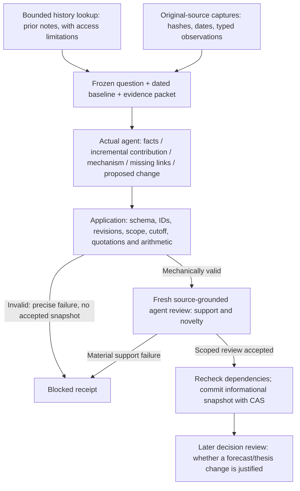

# NOW contribution handoff: execution and evaluation

This is an investment-owned, source-bound component using the existing phase
runner, model adapter, artifact store and snapshot CAS. It does not replace the
full-company finalizer or activate a production job/action. It does not determine
whether information is priced in.



## Runtime responsibilities

`investment.research.contribution_run.run_case` builds one concrete phase with
`CANDIDATE_OBJECTIVE`, the old hypotheses, the question, source excerpts and the
closed `PROPOSAL_SCHEMA`. These are delivered to the actual model, not merely
written in a design document. `investment.research.execution.run` validates the
structured response, then invokes `candidate_finalizer`; a validation exception
blocks completion. Native tools are disabled for this source-controlled test.

`validate_proposal` checks the actual resolved baseline and current Store records,
hashes source payloads, rejects future/unknown historical availability and later
source revisions, compares entity/period/currency/unit/basis, locates quotations,
and recomputes the numeric forecast delta. It cannot prove that an economic
inference follows from a quotation. `calculate_scenario` separately reuses the
Decimal/PV operators for explicitly conditional quantity, price, profit and FCFF.

The separate reviewer sees original excerpts and the exact old baseline. It
checks whether the inference is supported and whether the old hypothesis already
contains it. `checkpoint_review` binds the authentic author/reviewer receipts,
different session IDs, exact responses and proposal, revalidates dependencies,
then saves an informational checkpoint. No forecast, investment thesis or trade
is automatically committed. A model review is not a calibrated truth guarantee.

Catalog metadata and secondary notes provide old context; they are not silently
promoted to original evidence. The NOW packet includes a bounded query of the
existing catalog, preserving missing-body and historical-vintage limitations.

## Matched evaluation

`protocol.json` freezes eight atomic questions before model dispatch. Both arms
receive identical sources, controlled old hypotheses, schema, requested model,
effort and resource ceilings. A adds the explicit contribution objective and
typed host gate. B is competent generic structured research in the same runner;
it is not the older full-company admission gate. This estimates the combined
handoff intervention, not separate causal effects of each instruction/check.

Each actual proposal receives two fresh anonymous source reviews in opposite
presentation orders. The complete roster, attempts, authentic usage and missing
outcomes are retained. Arm labels and later financial outcomes are withheld from
the reviewer packets, but there is no OS-isolated or human-calibrated blindness.

Report source-supported fact precision, unsupported economic inference, false
novelty, specific missing links, counterevidence, unsupported numerical revisions,
missed material contributions, critical failures and runtime cost separately.
Order disagreements remain visible. Do not turn ordinal scores into statistical
confidence or count eight correlated NOW questions as eight investments.

Only FY2025Q2 subscription revenue has a verified later actual in this corpus.
Two questions share that target; FY2025Q3 remains unresolved. Signed/absolute
errors are descriptive by target. This cannot establish reduced forecasting
bias, significance, alpha or a universally superior update policy.

## Reproduction and lifecycle

Use the existing workspace-local research environment, without new dependencies:

```sh
PYTHONDONTWRITEBYTECODE=1 TMPDIR="$PWD/.niulai-state/reports/research-sources/tmp" \
  .research-sources/.venv/bin/python -m unittest \
  investment.research.tests.test_contribution -v
```

`prepare.py` freezes source-bound inputs; `run.py setup`, `execute`, `reviews`
and `finalize` are sequential one-round operations. Existing rounds are not
overwritten. Do not rerun these commands in an already claimed study directory.
The evidence-runtime contract checks source/expected/budget pins at begin/finish.
Transport failures and implementation repairs require explicit diagnosis and a
new version; unfavorable quality alone never justifies a rerun.

`tuning.evals.now_contribution_faults` mutates captured valid proposals to test
mechanical boundary coverage. Shape-only acceptance of a mutant is not evidence
that an older domain finalizer would accept it, nor a natural model error rate.
Captured-output repair replay does not regenerate agent answers or add new
independent quality cases.

`tuning.evals.now_contribution_acceptance setup --change CHANGE_ID` stages one
temporary future allocation after component checks and setup documentation sync.
It uses the existing Engine, authentication lock and configured model profile,
with a fresh author and reviewer session, strict support checks, independent
receipt/snapshot readback, one attempt and a bounded window. Its source captures
are fixed; it does not test fresh provider fetching or activate production.
The temporary label is unloaded after inspection. The supervising agent sends
and verifies the configured-owner result summary under the runtime acceptance
contract; the helper does not send business email.

The [dated report](../../../docs/plans/now-contribution-e2e.md) records actual
results and limits. The original failed v1/v1.0.1 ledgers and source history remain
intact. Guard 1.0.2 was tested by `now_contribution_replay` on all 16 captured
answers plus the complete fault matrix. `now_contribution_regrade` seals a new
captured-only host grading round with corrected content-identity binding, without
new author/reviewer answers. Neither repair replay adds an independent quality
sample. A fresh scheduled margin-case path passed; exact email status remains in
the private acceptance record.
