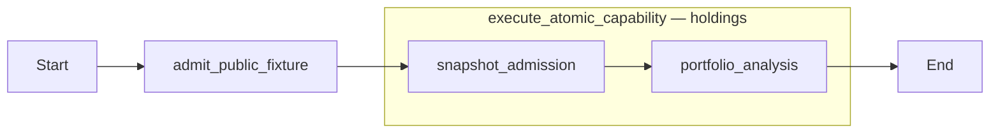
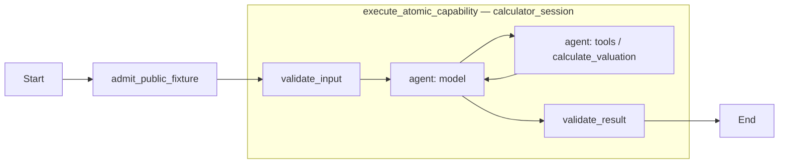

# Practical MCP and Studio snapshot

The isolated MCP path now runs the deployed synthetic calculator/holdings tools
and lets a current-host `create_agent` inspect their real LangSmith traces. MCP
is useful for running a workflow and opening its recorded execution, separately
from Studio's browser connection. No native-host MCP registration was enabled.

The local endpoint is `http://127.0.0.1:2025/mcp`; remote trace inspection uses
`https://api.smith.langchain.com/mcp`. Actual discovery, protocol negotiation,
tool schemas, calls and scoped readback were exercised. The hosted Remote MCP
is the maintained LangSmith route; the older standalone server is deprecated.
[Agent Server MCP](https://docs.langchain.com/langsmith/server-mcp),
[Remote MCP](https://docs.langchain.com/langsmith/langsmith-remote-mcp),
[standalone server status](https://docs.langchain.com/langsmith/langsmith-mcp-server).

Use this fixed Studio connection:

<https://smith.langchain.com/studio/?baseUrl=http://127.0.0.1:2025>

| What to inspect | Studio graph ID | Assistant name | Verified execution |
| --- | --- | --- | --- |
| Deterministic calculation | `calculator` | `calculator` | Public nominal returns per-share `10`; actual calculator tool, no model inference |
| Calculator agent workflow | `trading_pilot` | `calculator_session` | Validation → agent/model/tools → result validation; host services model replies |
| Holding workflow | `holdings` | `holdings` | Synthetic snapshot admission → maintained portfolio analysis subgraph |

All three registered graphs and their schemas were reread from the actual2025
service. `graph?xray=true` returns the holdings and cooperative calculator
subgraphs. In Studio use Graph mode, select the intended graph, then select and
activate its assistant in Settings / Manage Assistants. The original2024 server
has a different roster and remains preserved. The service must be running on
this computer; the localhost URL is not a hosted deployment or autostart claim.
[Studio assistant selection](https://docs.langchain.com/langsmith/use-studio).

The holding subgraph returned by the deployed API is:



The cooperative calculator workflow is:



This second diagram omits the displayed budget middleware branches for clarity.
The exact deployed node/edge records remain in the private Studio readiness
receipt. It does not imply unattended model dispatch or real holdings retrieval.

Studio View Raw requires the full envelope:

```json
{"request":{"case_id":"nominal"}}
```

The separate Request form takes just `{"case_id":"nominal"}`. For holdings,
`public-holdings-long-short` returns net positions700, gross1100, cash300 and
NAV1000. `public-holdings-partial-empty` is an expected explicit rejection.
These are fixed synthetic cases. The old bare-input failure and invalid Resume
history were retained rather than deleted. Use deterministic graphs for a
self-test without model handoff. The MCP inspection agent handles its own
private host handoff; it does not ask the user to paste protocol JSON.

The three retained Studio example threads were reread with terminal state and
their expected results; their private identities and exact state URLs are in
`runtime/mcp-agent/studio-persistent-examples.json`. Choose the graph first and
then that retained thread in Studio's right-hand thread selector. The thread
for the calculator agent contains its actual model/tool workflow.

MCP calls and Studio history have different lifecycles. The deployed MCP
endpoint answers each independent call with JSON; it waits for the graph's
complete result. A finished MCP-created thread was no longer available by the
state API (404). The ordinary Studio/API threads above remain available. Use
their retained IDs for workflow history rather than assuming every MCP invocation
will create a durable Studio example.
[MCP session behavior](https://docs.langchain.com/langsmith/server-mcp).

An API working locally does not prove Studio's HTTPS page can access it.
Official guidance identifies Chrome Local Network Access and Safari localhost
restrictions. Browser connection stability was not independently observed in
this task; no browser permission or global network setting was changed.
[Studio connection troubleshooting](https://docs.langchain.com/langsmith/troubleshooting-studio).

The final matched comparison used two immutable owned synthetic traces and four
actual MCP inspections. Both views retained the exact root, four-node roster,
parent ancestry, terminal status and complete outputs. The current host supplied
three bounded model messages; LangChain executed the tools. Four query HTTP
attempts returned four pages, with zero retries.

| Trace | Full model-visible response | Compact response | Paired truth |
| --- | ---: | ---: | --- |
| Calculator | 11,273 UTF-8 bytes | 6,246 UTF-8 bytes | Exact match |
| Holdings | 47,523 UTF-8 bytes | 31,831 UTF-8 bytes | Exact match |

Use compact inspection for the first result/tree check, with full inspection
available for inputs, events and execution details. This two-trace result
supports response-byte reduction only. It does not establish token, cost,
investment-alpha or general model-quality improvement.

The transport discovers the actual deployed contract rather than copying the
tutorial API. It rejects redirects, external schema references, mismatched
protocol/RPC identity, unbounded responses/pages and foreign result scope. A
single bounded retry authority honors Retry-After for classified reads; local
graph calls can create state and remain fenced after uncertainty. Rate policy,
warmup, attempts and result hashes are recorded separately from model responses.

The last local calculator self-test exposed a practical limit: the server-side
calculation/trace path completed after14.857335 seconds, while the client stopped
at its frozen10-second attempt deadline. Its acknowledgement remains UNKNOWN
and fenced. Exact native readback confirmed the owned calculation output10;
the RPC-to-thread correlation is not protocol-attested, and no acknowledgement
was fabricated or call replayed. The timing overlapped the26-case cloud
evaluation/readback; contention is a possible explanation, not a measured sole
cause. The endpoint's synchronous `runs.wait` path is independently visible in
the pinned Agent Server implementation. The never-attempted holdings call was
handled separately. Do not call the final local two-tool acknowledgement gate
PASS based on the earlier successful candidate or recovered native output.

For longer controllable workflows, persistent thread/run lifecycle APIs can
publish a known run identity before waiting; that is a separate integration
contract. The current MCP candidate does not silently replace its real graph
tool call with that API or enlarge the frozen timeout to obtain a pass.

The source Lark document was read at revision4473 and privately preserved with
SHA256 `654269626985fa210b39eb72e2238e7cc2a15a5cb2bc10d170babea2060bc4ba`.
Its practical mechanisms informed tool discovery, agent composition, checkpoint
handoff and small matched experiments. Older agent constructors were adapted to
the installed LangChain1.5 `create_agent`. The raw document, credentials and
account/runtime archives are excluded from this public takeaway and source
snapshot. Infrastructure mentioned by the tutorial was not automatically installed.

Setup/recovery: [component runbook](../../docs/deployment/langchain-mcp.md).
Scope and execution evidence: [verification](VERIFICATION.md).
The final hash-sealed source snapshot and evidence references stay under private
`.langchain-pilot/runtime/mcp-snapshots/`. Hash sealing detects later edits; it
is not an OS-level immutability or same-user security claim. Major scheduled
business/email acceptance and active native-host rollout remain unverified.
